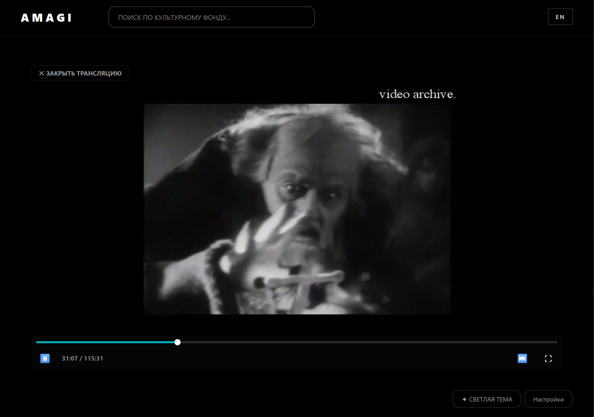
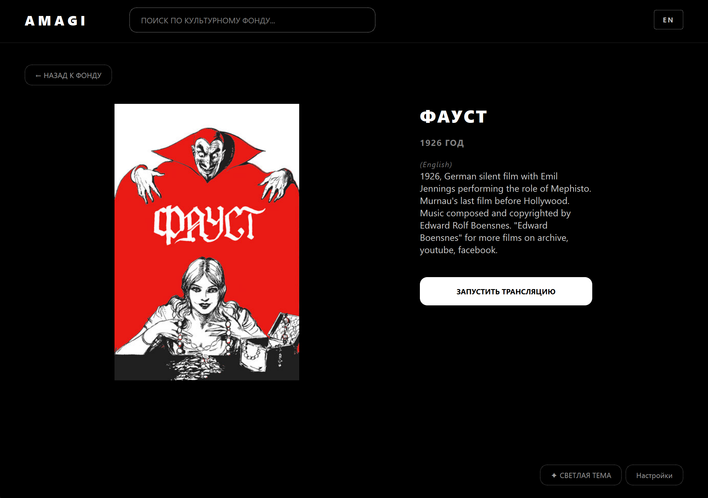
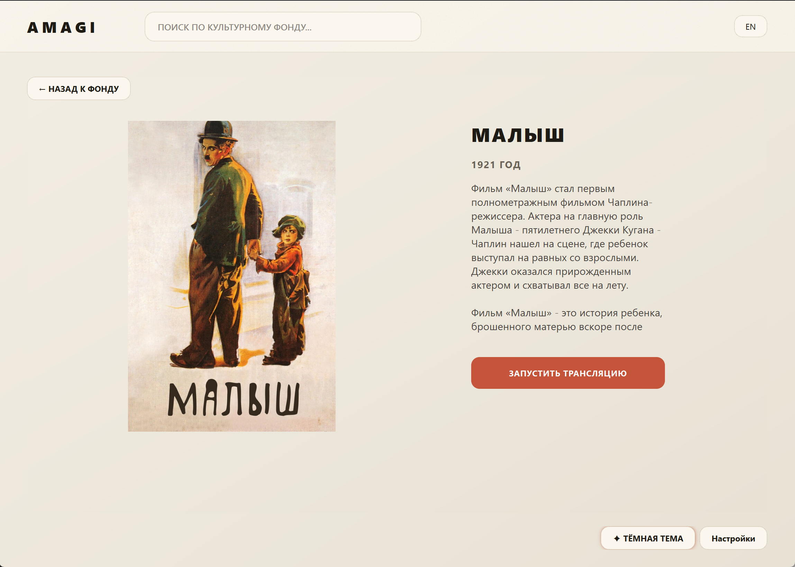

[🇬🇧 English](README.md) | [🇷🇺 Русский](README.ru.md)

<div align="center">

# Amagi-Player

**A desktop player for discovering and streaming public-domain films from open archives.**

[](https://www.gnu.org/licenses/gpl-3.0)
[](https://www.python.org/)
[-lightgrey)]()

</div>

## Screenshots

### Dark theme (OLED)

<div align="center">

| | |
|---|---|
|  |  |
|  |  |

</div>

### Light theme (Aurora Glass)

<div align="center">

| | |
|---|---|
|  |  |

</div>

---

## About

Amagi-Player is a desktop application for discovering and streaming
audiovisual works that are in the **public domain** or distributed by
rights holders under open terms (Creative Commons, Open Access, and
similar regimes).

The application is built around **Internet Archive** — one of the
largest open archives in the world, with a public API and direct HTTP
file delivery. Amagi-Player uses the standard Internet Archive
mechanisms (`advancedsearch`, `metadata`, `download`) and does not
host or redistribute the works themselves. It is a client, not a
library.

The application runs **locally**, with no analytics or telemetry.
Network requests go only to the sources the user chooses to search
and play from.

## Naming

The project is called **Amagi-Player**. The name is inspired by the
ancient Sumerian word 𒂼𒄄 *ama-gi* ("freedom", "return to the
mother").

The repository slug is `ama-gi-player` (hyphenated, legacy from the
Sumerian form). The executable is `amagi-player` (no hyphen). Both
refer to the same project.

---

## Features

### Public mode — supported

This is the supported mode and the only one documented for end
users. It focuses entirely on legal, public-domain content.

- Curated feed of public-domain films, bundled with the release and
  available offline
- Search by title across the local catalog
- Poster cascade: local cache → bundled posters → Internet Archive
  → optional Kinopoisk metadata
- Details card with title, year, description, and poster
- Streaming directly from `archive.org/download/...` via
  QMediaPlayer + FFmpeg (with HTTP Range seeking)
- "Continue watching" backed by local watch history
- Two UI themes (dark OLED, light Aurora Glass)
- Bilingual interface (English / Russian)
- No analytics, no telemetry, no accounts

### Private mode — experimental, for developers only

The private mode is an experimental testing ground for the search
architecture. It is **not** documented, **not** supported, and
**not recommended** for regular users. It exists in the codebase
for developers who want to extend or experiment with the search
pipeline.

What it contains, for reference:

- BitTorrent streaming via **libtorrent** — magnet links and
  `.torrent` files from external sources (not from Internet Archive)
- Integration with local **Jackett** / **Prowlarr** indexers
- User-defined sources via `data/sources.txt`
- Alternative-source picker shown when a stream is unstable
- Headless site parsing via **nodriver** to handle Cloudflare
  challenges on public trackers
- Custom tracker lists via `data/tracker_balancers.txt`
- Multiple-source search aggregation with a composite health score

None of the above is required for the public mode. If you are an
end user — stay in public.

### Technical

- Asynchronous architecture on `asyncio` + `qasync` — the UI stays
  responsive during search, buffering, and playback
- Blocking I/O (cache reads, poster writes) offloaded to
  `run_in_executor` — the event loop is never blocked
- Child process control via `psutil` — stuck helper processes are
  terminated cleanly
- LRU cache for Internet Archive metadata with TTL
- Graceful shutdown with cleanup of child processes, caches, and
  background tasks

---

## How it works

Public mode has two stages: **feed** (local) and **playback**
(network).

### Stage 1 — feed (local)

1. The user opens the app and sees a grid of film cards from the
   local curated catalog.
2. The user may type a query — the search runs against the local
   database (`data/whitelist.db`). For an empty query, the last
   N records are shown.
3. For each card, a poster is resolved through a cascade: local
   runtime cache → bundled seed posters → Internet Archive
   thumbnail → optional Kinopoisk metadata.
4. Clicking a card opens the details screen with title, year,
   description, and poster. Metadata comes from the local catalog;
   for records without a Kinopoisk ID, only the fields stored in
   the catalog are shown.

The catalog (`data/whitelist_seed.db`) is prepared in advance via
the tooling in `tools/` and ships inside the release archive
already populated. No network requests are required for stage 1.

### Stage 2 — playback (network)

When the user presses **Start streaming**, the player asks Internet
Archive for the film. The archive is a big, open, but not always
tidy place: metadata quality varies, several users often upload
the same film, and files inside a single item can range from a
clean MP4 to a DVD image that cannot be seeked over HTTP. The
search pipeline is built around these realities.

**1. Query cascade.** The search is not a single request. The
player tries a sequence of queries — by title, year, and media
type; then by title and year without the media-type filter; then
by title and media type without the year; and finally by title
alone. Each fallback exists because some archive records lack a
`year` or a `mediatype` field, and a strict first query would
miss them. The year is matched with a small tolerance, since
archive metadata is often off by a year or two.

**2. Candidate collection.** Every query returns a pool of
candidates. Instead of taking the top few by popularity, the
player keeps a wider pool and scores all of them. A famous
upload can drown a quieter but correct one if you only look at
download counts.

**3. Scoring.** Each candidate is ranked by:

- **Language match** — English preferred in public mode, with
  Russian as an alternate
- **Title accuracy** — how many meaningful words of the query
  appear in the title or identifier, ignoring stop-words
- **Popularity** — as a soft signal, not a hard filter

Silent-era films are handled specially: the language field is
**not** used as a disqualifier. Old films are often tagged with
the subtitle language rather than the original, and a strict
language filter would drop most of early cinema.

**4. File selection inside an item.** For each item that survived
scoring, the player fetches its metadata and scans the file list.
The chosen file is not necessarily the largest one — the player
**prefers progressive-friendly containers** (mp4, webm, mkv,
m4v) over DVD-era containers (mpeg, mpg, wmv, avi). This is a
deliberate tradeoff: an MP4 at half the size of an MPEG will
seek reliably over HTTP, while the MPEG may look fine at first
and then fail on the first seek because of DVD navigation
packets. DVD-era files are still accepted if nothing better
exists for that item — better something than nothing.

**5. Playback with retry.** The player picks the best candidate
and starts playback. If the stream fails — a network hiccup, a
5xx from the archive CDN, or an unsupported container — the
player retries the same URL once after a short delay. This
covers the transient CDN errors that archive.org occasionally
returns.

**6. Fallback across candidates.** If the retry also fails, the
player moves to the next candidate in the ranked list. Since a
single film is often uploaded several times by different users
under different item identifiers, the next candidate is
frequently a different upload of the same film — sometimes a
different format, sometimes a different quality. The cycle
continues until a working source is found or the list is
exhausted.

### Reliability

- **Format preference** over file size — the largest file is not
  necessarily the best one for HTTP streaming
- **Retry on transient errors** before switching to another source
- **Fallback across candidates** — several archive items for the
  same film are usually available
- **LRU metadata cache** — repeated searches do not re-fetch the
  same metadata
- **No blocking calls** in the UI thread

### Additional

- **Poster and metadata cache** — stored in `data/cache/`, with
  TTL-based invalidation
- **Watch history** — stored in `data/app_data.db`, backs the
  "Continue watching" feature

---

## How the release is built

The application is compiled with **Nuitka**. This is not a
bundler that packs `.py` files into an archive — it translates
Python into C, then compiles that C with a native toolchain
(MSVC on Windows), and links the result into a single
executable. Your code and the pure-Python libraries it depends
on end up as native machine code inside `amagi-player.exe`.

What sits next to the executable:

- **Qt6** runtime DLLs, plugin libraries, and QML/WebEngine
  resources
- **Python runtime** (`python3XX.dll`) — needed because the
  compiled code still uses the CPython object model at runtime
- **C-extension modules** that cannot be statically compiled —
  `libtorrent`, `curl_cffi`, and similar
- **Application data** — `data/`, `ui/`

That is why the unpacked folder is around **500 MB**: the
executable itself is a few tens of MB, and the rest is the
runtime and native dependencies. The ZIP in the release is much
smaller, because all of this compresses well.

The standalone build is deliberately not a single-file `.exe`.
A single file would have to unpack several hundred megabytes to
a temporary folder on every launch, which makes startup slow and
antivirus scanners unhappy. A folder starts instantly and keeps
everything in one place.

The build pipeline runs on GitHub Actions. For every release tag
it produces:

- Windows standalone archive — the supported build
- Linux standalone archive — experimental, requires system
  libraries, not tested on every distribution

---

## Technology stack

| Layer | Technology | Purpose |
|---|---|---|
| Language | Python 3.10+ | Primary language |
| GUI | PyQt6 | User interface |
| Event loop | qasync | Bridge between asyncio and Qt |
| HTTP | aiohttp | Async requests to Internet Archive |
| Media | QMediaPlayer + FFmpeg | Playback |
| Processes | psutil | Child process management |
| Streaming (private) | libtorrent | BitTorrent playback (experimental) |
| Build | Nuitka | Python → C → native executable |
| Tests | pytest | Unit tests |

---

## Architecture

```text
┌──────────────────────────────────────────────┐
│                  PyQt6 UI                    │
│            (qasync event loop)               │
└───────────────┬──────────────────────────────┘
                │
       ┌────────┴────────┐
       │                 │
   ┌───▼────┐        ┌───▼────┐
   │ Feed   │        │ Details│
   │ Cards  │        │ Screen │
   └───┬────┘        └───┬────┘
       │                 │
   ┌───▼──────┐      ┌───▼──────┐
   │ Local DB │      │ Stream   │
   │ (whitelist)     │Controller│
   └──────────┘      └───┬──────┘
                         │
                ┌────────┴────────┐
                │                 │
          ┌─────▼─────┐     ┌─────▼──────┐
          │ Internet  │     │ libtorrent │
          │ Archive   │     │ (private)  │
          │ (public)  │     └─────┬──────┘
          └───────────┘           │
                            ┌─────▼──────┐
                            │ Process    │
                            │ Manager    │
                            │ (psutil)   │
                            └────────────┘
```

Layers:

· UI — PyQt6 widgets, only rendering and signals
· Controllers — feed, details, stream; orchestrate state
· Services — Internet Archive search, metadata, playback
· Data — SQLite databases and file caches

The public mode touches only the Internet Archive branch. The
libtorrent branch exists for private mode and is not used by
regular builds.

---

Requirements

· Windows 10/11 — supported
· Linux — experimental build shipped in the same release, not
  tested on every distribution; requires system libraries (see
  README-LINUX.txt in the archive)
· ~300 MB of free disk space for the archive, ~500 MB unpacked
· Internet access for search and playback

For running from source you additionally need Python 3.10+.

---

Installation

From Releases (recommended)

1. Download the archive from the Releases page
2. Unpack it into any folder
3. Run amagi-player (Windows: amagi-player.exe)
4. Accept the terms of use

The local catalog data/whitelist.db ships in the archive already
populated. If it is removed, the next launch creates an empty
table and the feed stays empty until it is restored — see
tools/apply_seed.py in the source tree.

From source

```bash
git clone https://github.com/AkashaForge/ama-gi-player.git
cd ama-gi-player
python -m venv .venv
.venv\Scripts\activate        # Windows
pip install -r requirements.txt
python main.py
```

For development

```bash
pip install -r requirements-dev.txt
pytest
```

---

Usage

1. Launch the application and accept the terms.
2. Browse the feed or search by title.
3. Click a card to open details.
4. Press Start streaming — playback begins automatically.
5. Use the built-in player controls: play/pause, seek, fullscreen.
6. To resume later, use "Continue watching" on the main screen.

---

Configuration

Modes

The application runs in one of two modes, determined by the file
data/mode.txt. If the file is absent, public is used.

Mode Status Purpose
public Supported Internet Archive only. Default mode
private Experimental (developers) Extended architecture, not supported

Optional metadata

For extended film metadata (longer descriptions, high-resolution
posters), an optional Kinopoisk API key can be placed in a
.env file next to the executable:

```text
KP_API_KEY=your_key
```

Without the key, the application works entirely with metadata
already stored in the local catalog and with Internet Archive
metadata. Nothing is broken by its absence.

---

Diagnostics

The application prints diagnostic messages to the console
(opened alongside the executable). Useful lines:

Log line Meaning
Mode: PUBLIC Public mode is active
Feed: page=N, M films Feed loaded
IA query: ... Request to Internet Archive
IA result: N direct_url N playable candidates found
DEMUX ERROR Playback error — fallback or retry will follow

If the application does not start — run the executable from
PowerShell to see the full traceback:

```powershell
cd <folder>
.\amagi-player.exe
```

---

Project structure

```text
ama-gi-player/
├── controllers/          # Feed, details, stream controllers
├── core/                 # Event loop, logging, shared utilities
├── data/                 # Local catalog, cache, posters
│   ├── whitelist_seed.db # Curated catalog (ships with the release)
│   ├── whitelist.db      # Working copy (created on first launch)
│   └── cache/            # Runtime poster and metadata cache
├── database/             # SQLite repositories (catalog, history)
├── docs/
│   └── screenshots/      # README screenshots
├── search/               # Internet Archive search, aggregator, filters
├── services/             # Playback, Kinopoisk, process cleanup
├── tests/                # pytest test suite
├── tools/                # Seed and catalog utilities
├── ui/                   # PyQt6 widgets and styles
├── legal_gate.py         # Disclaimer dialog
├── legal_texts.py        # Disclaimer and privacy policy texts
├── main.py               # Entry point
├── config.py             # Configuration
├── requirements.txt
└── bin/                  # Optional external utilities (empty by default)
```

---

Legal information

Amagi-Player is distributed under the GNU General Public License v3.0.

· Full license text — LICENSE
· Third-party components — LICENSES.txt
· Attribution — NOTICE
· Code signing policy — CODE_SIGNING_POLICY.md
· Security policy — SECURITY.md
· Privacy policy — PRIVACY.md
· Terms of use and privacy policy are shown on first launch
  (see legal_texts.py)

In short:

· The application does not host or redistribute works.
· Default sources are open public-domain archives (Internet Archive).
· The application runs locally, without analytics or telemetry.

---

Contributing

PRs and Issues are welcome. See CONTRIBUTING.md.

By submitting a PR, you agree to license your contribution under GPLv3.

---

License

```text
Amagi-Player
Copyright (C) 2026 AkashaForge

This program is free software: you can redistribute it and/or modify
it under the terms of the GNU General Public License as published by
the Free Software Foundation, either version 3 of the License, or
(at your option) any later version.

This program is distributed in the hope that it will be useful,
but WITHOUT ANY WARRANTY; without even the implied warranty of
MERCHANTABILITY or FITNESS FOR A PARTICULAR PURPOSE. See the
GNU General Public License for more details.

You should have received a copy of the GNU General Public License
along with this program. If not, see <https://www.gnu.org/licenses/>.
```
