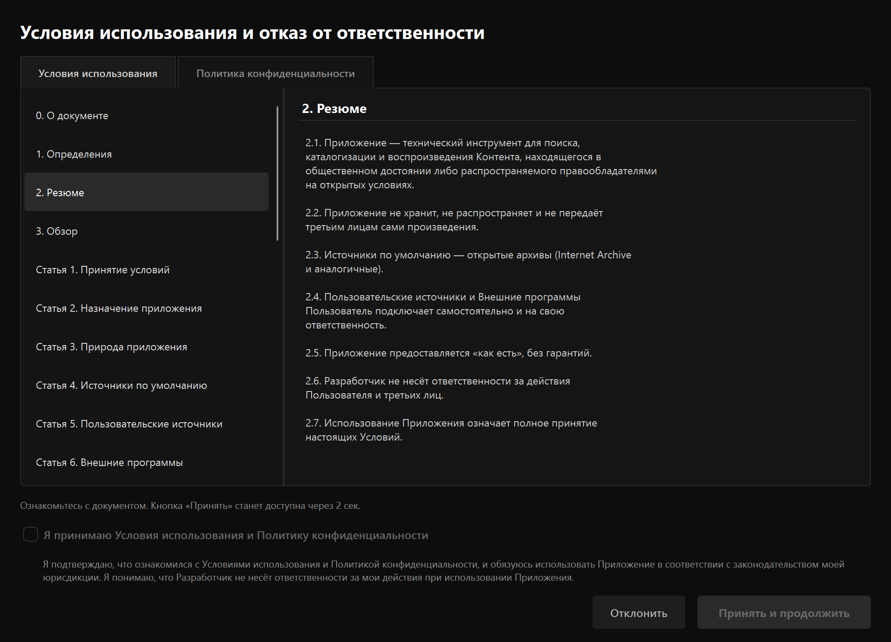
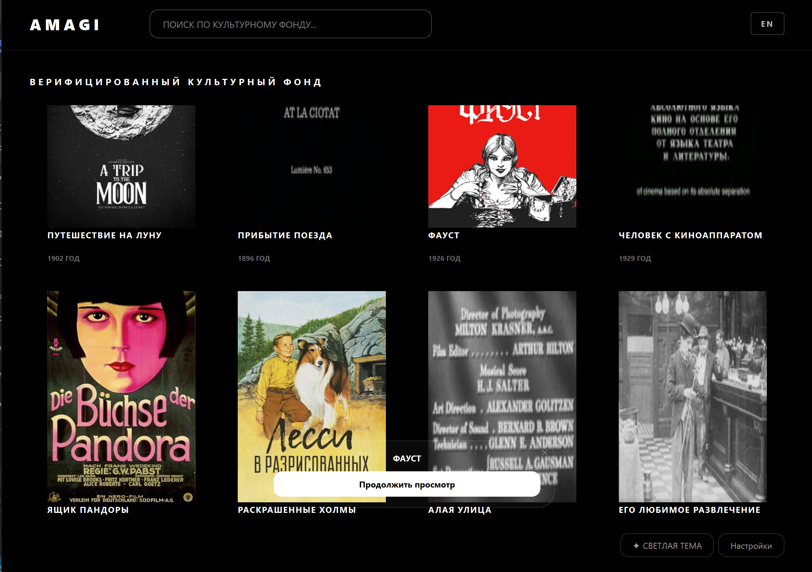
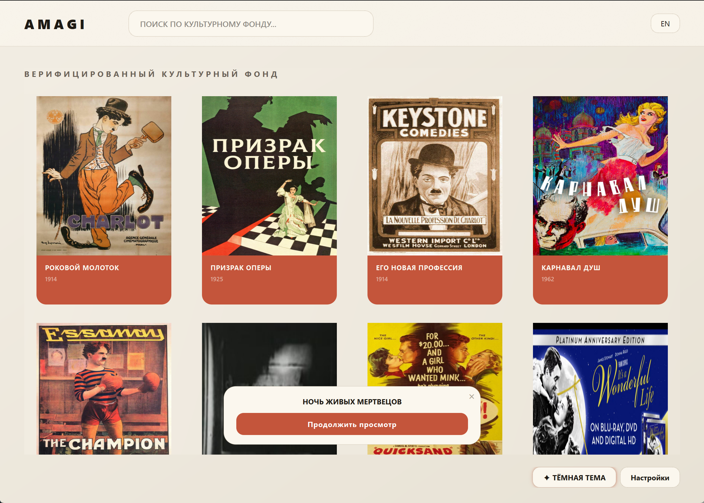
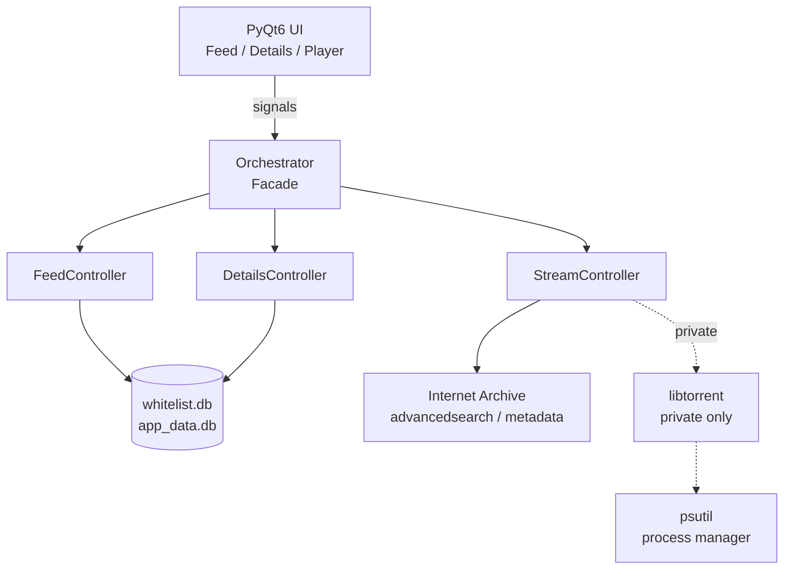
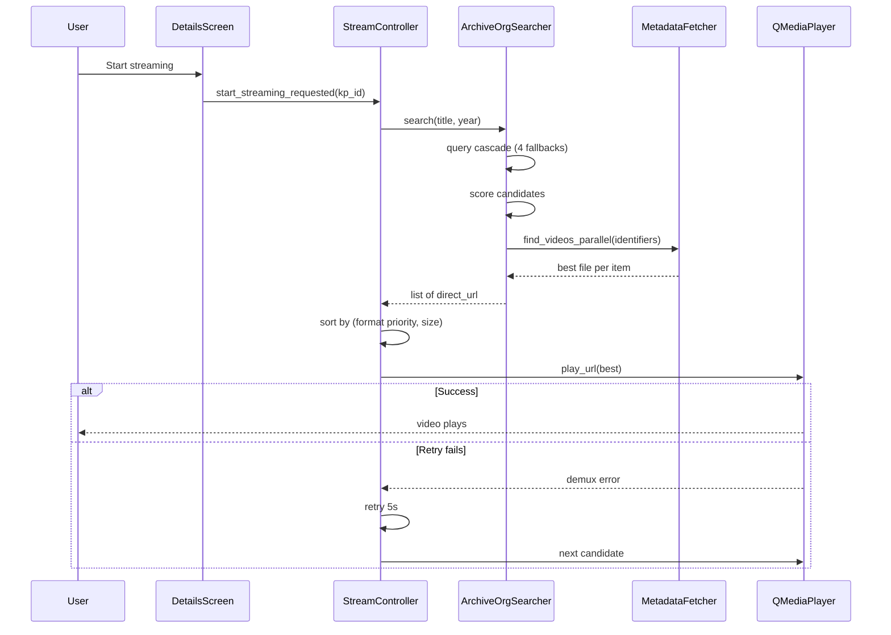

[🇬🇧 English](README.md) | [🇷🇺 Русский](README.ru.md)

<div align="center">

# Amagi-Player

**Stream public-domain cinema from Internet Archive — right on your desktop.**

[](https://github.com/AkashaForge/ama-gi-player/releases)
[](https://github.com/AkashaForge/ama-gi-player/actions/workflows/release.yml)
[](https://www.gnu.org/licenses/gpl-3.0)
[](https://www.python.org/)
[]()
[](http://makeapullrequest.com)

</div>

<p align="center">
  <a href="#features">Features</a> •
  <a href="#quick-start">Quick start</a> •
  <a href="#installation">Installation</a> •
  <a href="#usage">Usage</a> •
  <a href="#architecture">Architecture</a> •
  <a href="#faq">FAQ</a> •
  <a href="#contributing">Contributing</a>
</p>

<p align="center">
  <a href="https://github.com/AkashaForge/ama-gi-player/releases/latest">
    
  </a>
</p>

---

## Screenshots

### Dark theme (OLED)

<div align="center">

| | |
|---|---|
|  |  |
|  |  |

</div>

### Light theme (Gallery Editorial)

<div align="center">

| | |
|---|---|
|  |  |

</div>

---

<details>
<summary><strong>Table of Contents</strong></summary>

- [About](#about)
- [Naming](#naming)
- [Features](#features)
- [Quick start](#quick-start)
- [Installation](#installation)
- [Usage](#usage)
- [How it works](#how-it-works)
- [Concurrency and process control](#concurrency-and-process-control)
- [How the release is built](#how-the-release-is-built)
- [Technology stack](#technology-stack)
- [Architecture](#architecture)
- [Configuration](#configuration)
- [Diagnostics](#diagnostics)
- [Troubleshooting](#troubleshooting)
- [FAQ](#faq)
- [Development](#development)
- [Project structure](#project-structure)
- [Roadmap](#roadmap)
- [Contributing](#contributing)
- [Acknowledgments](#acknowledgments)
- [Legal information](#legal-information)
- [License](#license)

</details>

---

## About

Amagi-Player is a desktop application for discovering and streaming
audiovisual works that are in the **public domain** or distributed by
rights holders under open terms (Creative Commons, Open Access, and
similar regimes).

The application is built around **Internet Archive** — one of the
largest open archives in the world, with a public API and direct HTTP
file delivery. Amagi-Player uses the standard Internet Archive
mechanisms (`advancedsearch`, `metadata`, `download`) and does not
host or redistribute the works themselves. It is a client, not a
library.

The application runs **locally**, with no analytics or telemetry.
Network requests go only to the sources the user chooses to search
and play from.

## Naming

The project is called **Amagi-Player**. The name is inspired by the
ancient Sumerian word 𒂼𒄄 *ama-gi* ("freedom", "return to the
mother").

The repository slug is `ama-gi-player` (hyphenated, legacy from the
Sumerian form). The executable is `amagi-player` (no hyphen). Both
refer to the same project.

---

## Features

### Public mode — supported

This is the supported mode and the only one documented for end
users. It focuses entirely on legal, public-domain content.

- Curated feed of public-domain films, bundled with the release and
  available offline (~130 titles: early Chaplin, German
  expressionism, American copyright-lapse classics)
- Search by title across the local catalog
- Poster cascade: local cache → bundled posters → Internet Archive
  → optional Kinopoisk metadata
- Details card with title, year, description, and poster
- Streaming directly from `archive.org/download/...` via
  QMediaPlayer + FFmpeg (with HTTP Range seeking)
- "Continue watching" backed by local watch history
- Two UI themes (dark OLED, light Gallery Editorial)
- **Bilingual content search** (EN / RU) — the EN/RU toggle in the
  header switches the **search language** (which films to show),
  not the UI language. The interface is Russian-only at this time.
- No analytics, no telemetry, no accounts

### Private mode — experimental, for developers only

The private mode is an experimental testing ground for the search
architecture. It is **not** documented, **not** supported, and
**not recommended** for regular users. It exists in the codebase
for developers who want to extend or experiment with the search
pipeline.

What it contains, for reference:

- BitTorrent streaming via **libtorrent** — magnet links and
  `.torrent` files from external sources (not from Internet Archive)
- Integration with local **Jackett** / **Prowlarr** indexers
- User-defined sources via `data/sources.txt`
- Alternative-source picker shown when a stream is unstable
- Headless site parsing via **nodriver** to handle Cloudflare
  challenges on public trackers
- Custom tracker lists via `data/tracker_balancers.txt`
- Multiple-source search aggregation with a composite health score
- Optional TorAPI integration (requires subscription)

None of the above is required for the public mode. If you are an
end user — stay in public.

### Technical

- Asynchronous architecture on `asyncio` + `qasync` — the UI stays
  responsive during search, buffering, and playback
- Blocking I/O (cache reads, poster writes, torrent cleanup)
  offloaded to `run_in_executor` — the asyncio event loop stays
  responsive
- QMediaPlayer API is synchronous by Qt design; playback calls are
  wrapped in `QTimer.singleShot` where possible, but a brief UI
  delay on media stop is a known Qt limitation
- Child process control via `psutil` — stuck helper processes are
  terminated cleanly
- LRU cache for Internet Archive metadata with TTL
- Graceful shutdown with cleanup of child processes, caches, and
  background tasks

---

## Quick start

**Windows** (Windows 10/11 required):

1. Download the [latest release](https://github.com/AkashaForge/ama-gi-player/releases/latest)
2. Unpack the archive into any folder
3. Run `amagi-player.exe`

The film catalog is bundled — first playback is available
immediately.

**From source** (Python 3.10+):

```bash
git clone https://github.com/AkashaForge/ama-gi-player.git
cd ama-gi-player
python -m venv .venv
.venv\Scripts\activate          # Windows
# source .venv/bin/activate     # Linux
pip install -r requirements.txt
python main.py
```

---

## Installation

### From Releases (recommended)

1. Download the archive from the [Releases](https://github.com/AkashaForge/ama-gi-player/releases) page
2. Unpack it into any folder
3. Run `amagi-player` (Windows: `amagi-player.exe`)
4. Accept the terms of use

The local catalog `data/whitelist.db` ships in the archive already
populated — it is copied from `data/whitelist_seed.db` at build
time. If it is removed, the next launch creates an empty table and
the feed stays empty until it is restored — see
`tools/apply_seed.py` in the source tree.

### From source

```bash
git clone https://github.com/AkashaForge/ama-gi-player.git
cd ama-gi-player
python -m venv .venv
.venv\Scripts\activate        # Windows
pip install -r requirements.txt
python main.py
```

### Requirements

- **Windows 10/11** — supported
- **Linux** — experimental build shipped in the same release, not
  tested on every distribution; requires system libraries (see
  `README-LINUX.txt` in the archive)
- ~300 MB of free disk space for the archive, ~500 MB unpacked
- Internet access for search and playback
- Python 3.10+ (only for running from source)

---

## Usage

1. Launch the application and accept the terms.
2. Browse the feed or search by title.
3. Click a card to open details.
4. Press **Start streaming** — playback begins automatically.
5. Use the built-in player controls: play/pause, seek, fullscreen.
6. To resume later, use "Continue watching" on the main screen.

The header EN/RU toggle switches the **search language** (which
films to show). The UI itself is Russian-only at this time —
English localization is on the [roadmap](#roadmap).

---

## How it works

Public mode has two stages: **feed** (local) and **playback**
(network).

### Stage 1 — feed (local)

1. The user opens the app and sees a grid of film cards from the
   local curated catalog.
2. The user may type a query — the search runs against the local
   database (`data/whitelist.db`). For an empty query, the last
   N records are shown.
3. For each card, a poster is resolved through a cascade: local
   runtime cache → bundled seed posters → Internet Archive
   thumbnail → optional Kinopoisk metadata.
4. Clicking a card opens the details screen with title, year,
   description, and poster. Metadata comes from the local catalog;
   for records without a Kinopoisk ID, only the fields stored in
   the catalog are shown.

The catalog (`data/whitelist_seed.db`) is prepared in advance via
the tooling in `tools/` and ships inside the release archive
already populated. No network requests are required for stage 1.

### Stage 2 — playback (network)

When the user presses **Start streaming**, the player asks Internet
Archive for the film. The archive is a big, open, but not always
tidy place: metadata quality varies, several users often upload
the same film, and files inside a single item can range from a
clean MP4 to a DVD image that cannot be seeked over HTTP. The
search pipeline is built around these realities.

**1. Query cascade.** The search is not a single request. The
player tries a sequence of queries — by title, year, and media
type; then by title and year without the media-type filter; then
by title and media type without the year; and finally by title
alone. Each fallback exists because some archive records lack a
`year` or a `mediatype` field, and a strict first query would
miss them. The year is matched with a small tolerance (±2 years),
since archive metadata is often off by a year or two.

**2. Candidate collection.** Every query returns a pool of
candidates. Instead of taking the top few by popularity, the
player keeps a wider pool and scores all of them. A famous
upload can drown a quieter but correct one if you only look at
download counts.

**3. Scoring.** Each candidate is ranked by:

- **Language match** — English preferred in public mode, with
  Russian as an alternate
- **Title accuracy** — how many meaningful words of the query
  appear in the title or identifier, ignoring stop-words
- **Popularity** — as a soft signal, not a hard filter

Silent-era films are handled specially: the language field is
**not** used as a disqualifier. Old films are often tagged with
the subtitle language rather than the original, and a strict
language filter would drop most of early cinema.

**4. File selection inside an item.** For each item that survived
scoring, the player fetches its metadata and scans the file list.
The chosen file is not necessarily the largest one — the player
**prefers progressive-friendly containers** (mp4, webm, mkv,
m4v) over DVD-era containers (mpeg, mpg, wmv, avi). This is a
deliberate tradeoff: an MP4 at half the size of an MPEG will
seek reliably over HTTP, while the MPEG may look fine at first
and then fail on the first seek because of DVD navigation
packets. DVD-era files are still accepted if nothing better
exists for that item — better something than nothing.

**5. Playback with retry.** The player picks the best candidate
and starts playback. If the stream fails — a network hiccup, a
5xx from the archive CDN, or an unsupported container — the
player retries the same URL once after a short delay (5 s).
This covers the transient CDN errors that archive.org
occasionally returns.

**6. Fallback across candidates.** If the retry also fails, the
player moves to the next candidate in the ranked list. Since a
single film is often uploaded several times by different users
under different item identifiers, the next candidate is
frequently a different upload of the same film — sometimes a
different format, sometimes a different quality. The cycle
continues until a working source is found or the list is
exhausted.

### Reliability

- **Format preference** over file size — the largest file is not
  necessarily the best one for HTTP streaming
- **Retry on transient errors** before switching to another source
- **Fallback across candidates** — several archive items for the
  same film are usually available
- **LRU metadata cache** — repeated searches do not re-fetch the
  same metadata
- **No blocking calls** in the UI thread for search and metadata;
  QMediaPlayer API remains synchronous by Qt design and is
  minimized via `QTimer.singleShot`

### Additional

- **Poster and metadata cache** — stored in `data/cache/`, with
  TTL-based invalidation
- **Watch history** — stored in `data/app_data.db`, backs the
  "Continue watching" feature

---

## Concurrency and process control

The application runs on a single event loop shared by Qt and
asyncio. The bridge is **qasync**: it lets the Qt event loop drive
asyncio coroutines and vice versa, so there is no second thread,
no locks, and no races between UI code and networking code.

Network work — search, metadata, poster downloads — is written as
`async` / `await`. The UI stays interactive while it runs. Work
that cannot be made asynchronous (reading a file, writing a poster
to disk, opening the cache, cleaning a torrent download directory)
is offloaded to a thread pool via `run_in_executor`. The asyncio
event loop is not blocked by a syscall.

The QMediaPlayer API is synchronous by Qt design. Playback calls
that can be slow (`setSource`, `stop`) are wrapped in
`QTimer.singleShot` where possible to yield the main thread, but a
brief UI delay on media stop is a known Qt limitation — not a bug
in Amagi-Player.

Helper processes spawned by the search pipeline — Jackett in
private mode, headless browsers via `nodriver` — are tracked with
**psutil**. On startup, leftovers from previous crashed sessions
are killed before the UI appears. A periodic timer (once a minute)
terminates hung browser processes. On exit, the whole process tree
is cleaned up: even a hard crash in a previous run does not leave
orphans behind.

---

## How the release is built

The application is compiled with **Nuitka**. This is not a
bundler that packs `.py` files into an archive — it translates
Python into C, then compiles that C with a native toolchain
(MSVC on Windows), and links the result into a single
executable. Your code and the pure-Python libraries it depends
on end up as native machine code inside `amagi-player.exe`.

What sits next to the executable:

- **Qt6** runtime DLLs, plugin libraries, and QML/WebEngine
  resources
- **Python runtime** (`python3XX.dll`) — needed because the
  compiled code still uses the CPython object model at runtime
- **C-extension modules** that cannot be statically compiled —
  `libtorrent`, `curl_cffi`, and similar
- **Application data** — `data/`, `ui/`

That is why the unpacked folder is around **500 MB**: the
executable itself is a few tens of MB, and the rest is the
runtime and native dependencies. The ZIP in the release is much
smaller, because all of this compresses well.

The standalone build is deliberately not a single-file `.exe`.
A single file would have to unpack several hundred megabytes to
a temporary folder on every launch, which makes startup slow and
antivirus scanners unhappy. A folder starts instantly and keeps
everything in one place.

The build pipeline runs on GitHub Actions. For every release tag
it produces:

- Windows standalone archive — the supported build
- Linux standalone archive — experimental, requires system
  libraries, not tested on every distribution

---

## Technology stack

| Layer | Technology | Purpose |
|---|---|---|
| Language | Python 3.10+ | Primary language |
| GUI | PyQt6 | User interface |
| Event loop | qasync | Bridge between asyncio and Qt |
| HTTP | aiohttp | Async requests to Internet Archive |
| Media | QMediaPlayer + FFmpeg | Playback |
| Processes | psutil | Child process management |
| XML safety | defusedxml | Safe Torznab parsing (private mode) |
| Streaming (private) | libtorrent | BitTorrent playback (experimental) |
| HTTP fallback (private) | cloudscraper, curl_cffi | Cloudflare-bypass cascade |
| Browser automation (private) | nodriver | Headless site parsing (private mode) |
| Transport (private) | websockets | Underlying transport for nodriver |
| Build | Nuitka | Python → C → native executable |
| Tests | pytest | Unit tests |

---

## Architecture



Layers:

- **UI** — PyQt6 widgets, only rendering and signals
- **Controllers** — feed, details, stream; orchestrate state
- **Services** — Internet Archive search, metadata, playback
- **Data** — SQLite databases and file caches

The public mode touches only the Internet Archive branch. The
libtorrent branch exists for private mode and is not used by
regular builds.

### Playback flow (public mode)



---

## Configuration

### Modes

The application runs in one of two modes, determined by the file
`data/mode.txt`. If the file is absent, `public` is used.

| Mode | Status | Purpose |
|---|---|---|
| `public` | Supported | Internet Archive only. Default mode |
| `private` | Experimental (developers) | Extended architecture, not supported |

### Optional metadata

For extended film metadata (longer descriptions, high-resolution
posters), an optional **Kinopoisk API key** can be placed in a
`.env` file next to the executable:

```text
KP_API_KEY=your_key
```

Without the key, the application works entirely with metadata
already stored in the local catalog and with Internet Archive
metadata. Nothing is broken by its absence.

---

## Diagnostics

The application prints diagnostic messages to the console
(opened alongside the executable). Note that most log messages
are in **Russian** (the UI language); the table below maps them
to their meaning.

| Log line | Meaning |
|---|---|
| `[CONFIG] Режим: PUBLIC` | Public mode is active |
| `[CONFIG] Режим: PRIVATE` | Private mode is active |
| `Лента: page=N, M фильмов` | Feed page loaded |
| `IA query: title:(...)` | Search request sent to Internet Archive |
| `IA итог: N direct_url` | N playable candidates found |
| `StreamSession ready` | P2P stream configured, playback starting (private) |
| `wait_piece N: X.Xs` | Waiting for piece N for X.X seconds (private) |
| `DEMUX ERROR` | Playback error — retry or fallback will follow |
| `WATCHDOG: Xs, rate=Y, peers=Z → fallback` | Buffer stuck, switching to next source |

If the application does not start — run it from PowerShell to
see the full traceback:

```powershell
cd <folder>
.\amagi-player.exe
```

---

## Troubleshooting

### The app does not start on Windows

Windows SmartScreen may block an unknown `.exe`:

1. Right-click `amagi-player.exe` → **Properties**
2. At the bottom of the **General** tab, tick **Unblock**
3. Click OK → run again

If it still does not start, launch from PowerShell to see the
traceback:

```powershell
cd C:\path\to\amagi-player
.\amagi-player.exe
```

### Antivirus removes `amagi-player.exe`

Nuitka builds are sometimes falsely detected by antivirus
products (no code signature). This is a known issue for
Python-compiled executables. Options:

- Add the folder to your antivirus exceptions
- Download only from the official release page (not third-party mirrors)
- Build from source — see [How the release is built](#how-the-release-is-built)

Code signing is on the [roadmap](#roadmap).

### Linux: `error while loading shared libraries`

Install the required system libraries:

```bash
sudo apt install libxcb-cursor0 libegl1 libgl1 libnss3 libasound2 ffmpeg
```

The full list is in `README-LINUX.txt` inside the archive.

### No sound

1. Check the system mixer — the app does not mute audio
2. **Settings → Sound** — verify the output device
3. Some films are silent-era (pre-1930) and have no audio track
   in the source — this is normal, not a bug

### Search finds nothing

Try:

- Removing the year from the query
- Checking the EN/RU toggle in the header (it switches the
  **content** language, not the UI)
- Looking at the console: the `IA query: ...` line shows the
  real query sent to the archive

### "Window is not responding" when switching films

Known limitation of Windows Media Foundation: `QMediaPlayer` keeps
a file handle open longer than desired, and libtorrent cannot
remove a torrent until the storage is released. The code has a
sync fallback after 15 seconds — wait for it, switching will
complete.

For a smoother experience, switch to the FFmpeg backend by setting
the environment variable before launch:

```powershell
$env:QT_MEDIA_BACKEND = "ffmpeg"
.\amagi-player.exe
```

FFmpeg handles demuxing in a separate thread, which avoids the
main-thread stall on stop. This is not the default because it has
not been tested on all Windows configurations.

---

## FAQ

<details>
<summary><strong>Is this legal?</strong></summary>

Yes. The application works only with content in the public domain
from Internet Archive — an open archive with millions of free
works. The application does not host or redistribute works — it
is a client to the open archive API. See
[Legal information](#legal-information).

</details>

<details>
<summary><strong>Where do the films come from?</strong></summary>

Nowhere to "get" them — the catalog is bundled. It contains about
130 films verified as public domain (Chaplin 1914–1919, German
expressionism, American copyright-lapse classics). Search runs
against this catalog.

For more sources, you can switch to `private` mode (see
[Configuration](#configuration)) and connect external sources.
But this is an experimental developer mode.

</details>

<details>
<summary><strong>Why is there no English UI?</strong></summary>

The EN/RU toggle in the header switches the **search language**
(which films to show), not the UI language. The interface is
currently Russian-only. UI localization is on the
[roadmap](#roadmap).

</details>

<details>
<summary><strong>How do I change the theme?</strong></summary>

Use the **✦ Light theme** / **✦ Dark theme** button at the bottom
of the main screen. Two themes are available: dark OLED (default)
and light Gallery Editorial.

</details>

<details>
<summary><strong>Can I download a film instead of streaming it?</strong></summary>

There is no built-in "download" function. But streaming is served
from `archive.org/download/...` — an open URL that you can grab
with any download manager. The console log shows the exact URL.

</details>

<details>
<summary><strong>Does the app collect my data?</strong></summary>

No. No analytics, no telemetry, no accounts. All data is local:
watch history in `data/app_data.db`, poster cache in
`data/cache/`. Network requests go only to Internet Archive (and
Kinopoisk if a key is configured).

</details>

<details>
<summary><strong>What is `mode.txt`?</strong></summary>

The file `data/mode.txt` defines the mode:

- `public` (default) — Internet Archive only, legal content
- `private` — extended stack (libtorrent, Jackett, nodriver).
  Experimental, not for regular users

</details>

<details>
<summary><strong>The app freezes when switching films</strong></summary>

Known Windows Media Foundation limitation (see
[Troubleshooting](#troubleshooting)). Workaround: wait 2–3 seconds
after closing before starting the next film, or set
`QT_MEDIA_BACKEND=ffmpeg` before launch.

</details>

---

## Development

### Setup

```bash
git clone https://github.com/AkashaForge/ama-gi-player.git
cd ama-gi-player
python -m venv .venv
.venv\Scripts\activate          # Windows
# source .venv/bin/activate     # Linux
pip install -r requirements.txt
```

Dev tools (pytest, ruff, black, mypy) are not in
`requirements.txt` — install them manually:

```bash
pip install pytest ruff black mypy
```

### Running tests

```bash
pytest
```

### Linting and formatting

The project uses **ruff** (linter) and **black** (formatter).
Settings are in `pyproject.toml`.

```bash
ruff check .
ruff check . --fix
black .
```

### Commit style

Conventional Commits:

```
feat: add TorAPI source to coordinator
fix: async_remove_torrent not removing handles on cancel
docs: update troubleshooting for Windows MF
refactor: split StreamController into three sub-controllers
```

### Adding a dependency

If you genuinely need a new package:

1. Add it with a pinned version to `requirements.txt`
2. Update this README in **both** languages if the change is
   visible to users
3. Re-run the app and `pytest` to confirm nothing broke

---

## Project structure

```text
ama-gi-player/
├── controllers/              # Qt-контроллеры (state + UI ↔ services)
│   ├── orchestrator.py       # Facade, DI-контейнер
│   ├── feed_controller.py
│   ├── details_controller.py
│   └── stream/               # Stream subsystem
│       ├── stream_controller.py
│       ├── buffer_monitor.py
│       ├── cascade.py
│       └── fallback.py
├── core/                     # Инфраструктура
│   ├── config_loader.py
│   ├── logging_setup.py
│   ├── models.py
│   └── utils.py
├── data/                     # Локальные данные
│   ├── whitelist_seed.db     # Каталог (в релизе)
│   ├── whitelist.db          # Рабочая копия (создаётся из seed)
│   ├── app_data.db           # История просмотров
│   ├── cache/                # Runtime-кэш
│   ├── mode.txt              # public / private
│   └── sources.txt           # (private) пользовательские источники
├── database/                 # SQLite-репозитории
│   ├── connection.py
│   ├── whitelist_db.py
│   ├── whitelist_repo.py
│   ├── history_repo.py
│   ├── resolve_kp_ids.py
│   └── whitelist_seed.py
├── docs/
│   └── screenshots/
├── search/                   # Поисковый конвейер
│   ├── aggregator/           # Параллельный поиск
│   │   ├── coordinator.py
│   │   ├── language_filter.py
│   │   ├── source_counters.py
│   │   └── tasks/            # 6 источников (IA, Jackett, web, YTS, ...)
│   ├── archive_org/          # Internet Archive
│   │   ├── searcher.py
│   │   ├── metadata.py
│   │   └── language.py
│   ├── web_fetcher/          # Парсинг сайтов
│   │   ├── fetcher.py
│   │   ├── http_cascade.py   # curl_cffi → cloudscraper → aiohttp
│   │   ├── browser_fetcher.py
│   │   └── html_parser.py
│   ├── filters.py
│   ├── jackett_client.py
│   ├── prowlarr_client.py
│   └── torznab_parser.py
├── services/                 # Бизнес-логика
│   ├── torrent/              # P2P streaming (private)
│   │   ├── session/          # StreamSession подкомпоненты
│   │   ├── http_range_server.py
│   │   ├── piece_scheduler.py
│   │   ├── piece_map.py
│   │   ├── peer_monitor.py
│   │   ├── lt_session.py
│   │   ├── source_selector.py
│   │   ├── swarm_grouper.py
│   │   └── tracker_balancer.py
│   ├── playback_controller.py
│   ├── kp_service.py
│   ├── balancer_client.py
│   └── process_cleaner.py
├── tests/
│   └── test_smoke.py
├── tools/                    # Утилиты сборки каталога
│   ├── make_seed.py
│   ├── enrich_whitelist.py
│   ├── apply_seed.py
│   ├── verify_whitelist.py
│   ├── manage_whitelist.py
│   └── cache_stats.py
├── ui/                       # PyQt6-виджеты и стили
│   ├── main_window.py
│   ├── setup_wizard.py
│   ├── source_picker_dialog.py
│   ├── styles.qss
│   └── widgets/
├── legal_gate.py
├── legal_texts.py
├── switch_mode.py            # public ↔ private
├── main.py
├── config.py
├── pyproject.toml
├── nuitka-package-config.yml
├── requirements.txt
└── bin/                      # Опциональные внешние утилиты
```

---

## Roadmap

Planned improvements (not guaranteed, no schedule):

### Near term

- [ ] English UI localization (i18n via `QTranslator`) — the
  EN/RU toggle currently switches only the search language
- [ ] Tests for fallback logic (public retry, private auto-fallback)
- [ ] Full Linux CI (currently experimental)

### Medium term

- [ ] Code signing (Windows) — removes SmartScreen and some
  false-positive antivirus warnings
- [ ] `QT_MEDIA_BACKEND=ffmpeg` as default on Windows — bypasses
  some MF limitations
- [ ] Improved poster loading (progressive loading, blurhash
  placeholders)

### Long term

- [ ] macOS build
- [ ] ARM64 (Apple Silicon, Windows on ARM)
- [ ] Plugin system for sources (currently `sources.txt`)

If you'd like to help — see [Contributing](#contributing).

---

## Contributing

PRs and Issues are welcome. Before a substantial PR:

1. Open an issue describing the idea — discuss the approach
2. Fork and create a branch from `main`
3. Run `pytest` and `ruff check .` locally
4. Open a PR with a description and a link to the issue

See [`CONTRIBUTING.md`](CONTRIBUTING.md) for details.

By submitting a PR, you agree to license your contribution under
**GPLv3**.

### Good first issues

Issues tagged [`good first issue`](https://github.com/AkashaForge/ama-gi-player/labels/good%20first%20issue)
are specifically selected for newcomers.

---

## Acknowledgments

The project stands on the shoulders of excellent open-source
tools:

- **[Internet Archive](https://archive.org)** — an open archive
  with millions of public-domain works. The project would not
  exist without it.
- **[PyQt6](https://riverbankcomputing.com/software/pyqt/)** —
  Qt bindings for Python.
- **[qasync](https://github.com/CabbageDevelopment/qasync)** —
  asyncio ↔ Qt event-loop bridge.
- **[Nuitka](https://nuitka.net)** — Python → C compiler.
- **[libtorrent](https://libtorrent.org)** (rasterbar) —
  BitTorrent library (private mode).
- **[aiohttp](https://docs.aiohttp.org)** — async HTTP.
- **[curl_cffi](https://github.com/lexiforest/curl_cffi)** —
  TLS fingerprinting for CF bypass.
- **[nodriver](https://github.com/ultrafunkamsterdam/nodriver)** —
  headless Chrome without webdriver.
- **[Kinopoisk Unofficial API](https://kinopoiskapiunofficial.tech)** —
  optional metadata.

Special thanks to:

- The **Internet Archive** community for open data
- PyQt6 and qasync maintainers for answering questions on GitHub
- Authors of public-domain films — for cultural heritage

### Icons

- [Feather Icons](https://feathericons.com) — UI icons (MIT license)
- Emoji flags — system font

---

## Legal information

Amagi-Player is distributed under the **GNU General Public License v3.0**.

- Full license text — [`LICENSE`](LICENSE)
- Third-party components — [`LICENSES.txt`](LICENSES.txt)
- Attribution — [`NOTICE`](NOTICE)
- Code signing policy — [`CODE_SIGNING_POLICY.md`](CODE_SIGNING_POLICY.md)
- Security policy — [`SECURITY.md`](SECURITY.md)
- Privacy policy — [`PRIVACY.md`](PRIVACY.md)
- Terms of use and privacy policy are shown on first launch
  (see `legal_texts.py`)

In short:

- The application does not host or redistribute works.
- Default sources are open public-domain archives (Internet Archive).
- The application runs locally, without analytics or telemetry.

---

## License

```text
Amagi-Player
Copyright (C) 2026 AkashaForge

This program is free software: you can redistribute it and/or modify
it under the terms of the GNU General Public License as published by
the Free Software Foundation, either version 3 of the License, or
(at your option) any later version.

This program is distributed in the hope that it will be useful,
but WITHOUT ANY WARRANTY; without even the implied warranty of
MERCHANTABILITY or FITNESS FOR A PARTICULAR PURPOSE. See the
GNU General Public License for more details.

You should have received a copy of the GNU General Public License
along with this program. If not, see <https://www.gnu.org/licenses/>.
```