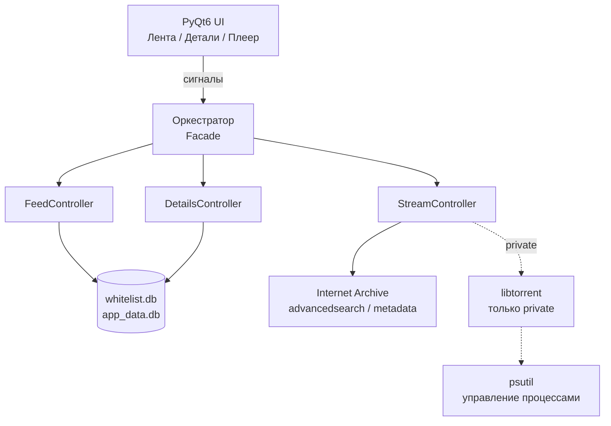
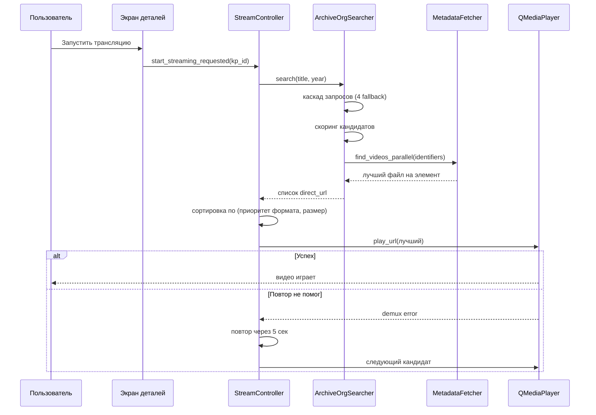

[🇬🇧 English](README.md) | [🇷🇺 Русский](README.ru.md)

<div align="center">

# Amagi-Player

**Десктоп-плеер для поиска и воспроизведения фильмов общественного достояния из открытых архивов.**

[](https://www.gnu.org/licenses/gpl-3.0)
[](https://www.python.org/)
[-lightgrey)]()

</div>

## Скриншоты

### Тёмная тема (OLED)

<div align="center">

| | |
|---|---|
|  |  |
|  |  |

</div>

### Светлая тема (Aurora Glass)

<div align="center">

| | |
|---|---|
|  |  |

</div>

---

## О проекте

Amagi-Player — десктопное приложение для поиска и воспроизведения
аудиовизуальных произведений, находящихся в **общественном
достоянии** либо распространяемых правообладателями на открытых
условиях (Creative Commons, Open Access и аналогичные режимы).

Приложение построено вокруг **Internet Archive** — одного из
крупнейших открытых архивов в мире, с публичным API и прямой
HTTP-доставкой файлов. Amagi-Player использует штатные механизмы
архива (`advancedsearch`, `metadata`, `download`) и не хранит
и не распространяет сами произведения. Это клиент, а не библиотека.

Приложение работает **локально**, без аналитики и телеметрии.
Сетевые запросы идут только к тем источникам, которые пользователь
явно использует для поиска и воспроизведения.

## Название

Проект называется **Amagi-Player**. Название вдохновлено
древнешумерским словом 𒂼𒄄 *ama-gi* («свобода», «возвращение к
матери»).

Слаг репозитория — `ama-gi-player` (с дефисом, унаследовано от
шумерской формы). Исполняемый файл — `amagi-player` (без дефиса).
Оба варианта относятся к одному проекту.

---

## Возможности

### Public-режим — поддерживается

Это поддерживаемый режим и единственный, документированный для
конечных пользователей. Он целиком сосредоточен на легальном
контенте общественного достояния.

- Курированная лента фильмов общественного достояния, поставляется
  вместе с релизом и доступна офлайн
- Поиск по названию в локальном каталоге
- Каскад постеров: локальный кэш → постеры из релиза →
  Internet Archive → опционально Кинопоиск
- Карточка фильма: название, год, описание, постер
- Стриминг напрямую с `archive.org/download/...` через
  QMediaPlayer + FFmpeg (с HTTP Range для перемотки)
- Функция «Продолжить просмотр» на основе локальной истории
- Две темы интерфейса (тёмная OLED, светлая Aurora Glass)
- Двуязычный интерфейс (русский / английский)
- Без аналитики, телеметрии и аккаунтов

### Private-режим — экспериментальный, только для разработчиков

Private-режим — это экспериментальная площадка для тестирования
архитектуры поиска. Он **не** документируется, **не** поддерживается
и **не рекомендуется** обычным пользователям. Он существует в
коде для разработчиков, которые хотят расширять или
экспериментировать с поисковым конвейером.

Что в нём есть — для справки:

- Потоковое воспроизведение через **libtorrent** — magnet-ссылки
  и `.torrent`-файлы от внешних источников (не из Internet Archive)
- Интеграция с локальными индексаторами **Jackett** / **Prowlarr**
- Пользовательские источники через `data/sources.txt`
- Окно выбора альтернативного источника при нестабильном стриме
- Headless-парсинг сайтов через **nodriver** для обхода Cloudflare
  на публичных трекерах
- Пользовательские списки трекеров через `data/tracker_balancers.txt`
- Мультиисточниковый поиск с составным health-score

Ничего из этого не требуется для public-режима. Если вы
пользователь — оставайтесь в public.

### Технические особенности

- Асинхронная архитектура на `asyncio` + `qasync` — интерфейс не
  блокируется во время поиска, буферизации и воспроизведения
- Блокирующий I/O (чтение файлов кэша, запись постеров) вынесен в
  `run_in_executor` — event loop никогда не блокируется
- Контроль дочерних процессов через `psutil` — «повисшие»
  процессы завершаются корректно
- LRU-кэш метаданных Internet Archive с TTL
- Аккуратное завершение работы с очисткой дочерних процессов,
  кэшей и фоновых задач

---

## Как это работает

Public-режим состоит из двух этапов: **лента** (локально) и
**воспроизведение** (сеть).

### Этап 1 — лента (локально)

1. Пользователь открывает приложение и видит сетку карточек из
   локального курированного каталога.
2. Пользователь может ввести запрос — поиск идёт по локальной
   базе (`data/whitelist.db`). Для пустого запроса показываются
   последние записи каталога.
3. Для каждой карточки постер разрешается каскадом: локальный
   runtime-кэш → постеры из seed → превью с Internet Archive →
   опционально Кинопоиск.
4. Клик по карточке открывает экран деталей с названием, годом,
   описанием и постером. Метаданные берутся из локального
   каталога; для записей без идентификатора Кинопоиска
   показываются только поля, сохранённые в каталоге.

Каталог (`data/whitelist_seed.db`) готовится заранее утилитами из
`tools/` и поставляется в архиве уже заполненным. Для этапа 1
сетевые запросы не требуются.

### Этап 2 — воспроизведение (сеть)

Когда пользователь нажимает **«Запустить трансляцию»**, плеер
идёт на Internet Archive. Архив — большой, открытый, но не
всегда аккуратный: качество метаданных разнится, один и тот же
фильм часто залит несколько раз разными пользователями, а файлы
внутри одного элемента могут быть и чистым MP4, и DVD-образом,
который не перематывается по HTTP. Поисковый конвейер построен
с учётом этой реальности.

**1. Каскад запросов.** Поиск — не один запрос, а серия. Плеер
пробует по очереди: по названию, году и типу медиа; по названию и
году без фильтра по типу; по названию и типу медиа без года; и
только по названию. Каждый fallback нужен потому, что у части
записей архива нет поля `year` или `mediatype`, и строгий первый
запрос их бы отсеял. Год сопоставляется с небольшим допуском —
метаданные архива часто ошибаются на год-два.

**2. Сбор кандидатов.** Каждый запрос возвращает пул кандидатов.
Вместо того чтобы брать несколько верхних по популярности, плеер
держит более широкий пул и скорирует всех. Известная загрузка
может «утопить» более тихую, но правильную, если смотреть только
на число скачиваний.

**3. Скоринг.** Каждый кандидат оценивается по:

- **Совпадению языка** — в public-режиме предпочтителен английский,
  русский как альтернатива
- **Точности названия** — сколько значимых слов запроса
  встречается в названии или идентификаторе, без учёта
  стоп-слов
- **Популярности** — как мягкий сигнал, не жёсткий фильтр

Немое кино обрабатывается отдельно: язык **не** используется как
дисквалификатор. Старые фильмы часто помечены языком субтитров, а
не оригинальным, и строгий языковой фильтр отсеял бы большую часть
раннего кино.

**4. Выбор файла внутри элемента.** Для каждого кандидата, прошедшего
скоринг, плеер загружает метаданные и сканирует список файлов.
Выбранный файл — не обязательно самый большой: плеер
**предпочитает прогрессивные контейнеры** (mp4, webm, mkv, m4v)
перед DVD-эпохой (mpeg, mpg, wmv, avi). Это осознанный
компромисс: MP4 вдвое меньшего размера будет надёжно
перематываться по HTTP, а MPEG может выглядеть нормально вначале
и сломаться на первой же перемотке из-за DVD navigation-пакетов.
Файлы DVD-эпохи всё равно принимаются, если лучшего варианта в
этом элементе нет — лучше что-то, чем ничего.

**5. Воспроизведение с повтором.** Плеер берёт лучшего кандидата и
запускает воспроизведение. Если стрим упал — сетевой сбой, 5xx от
CDN архива или неподдерживаемый контейнер — плеер повторяет
запрос к тому же URL один раз через короткую задержку. Это
покрывает временные ошибки CDN, которые archive.org иногда
возвращает.

**6. Fallback по кандидатам.** Если повтор тоже не помог, плеер
переходит к следующему кандидату в упорядоченном списке.
Поскольку один и тот же фильм часто залит несколько раз под
разными идентификаторами, следующий кандидат — часто другая
загрузка того же фильма: иногда другого формата, иногда другого
качества. Цикл продолжается, пока не найдётся рабочий источник
или пока не закончатся кандидаты.

### Надёжность

- **Приоритет формата** важнее размера файла — самый большой файл
  не обязательно лучший для HTTP-стриминга
- **Повтор при временных ошибках** перед переключением на другой
  источник
- **Перебор кандидатов** — для одного фильма на архиве обычно
  есть несколько элементов
- **LRU-кэш метаданных** — повторные поиски не дёргают архив
  заново
- **Никаких блокирующих вызовов** в UI-потоке

### Дополнительно

- **Кэш постеров и метаданных** — в `data/cache/`, с инвалидацией
  по TTL
- **История просмотров** — в `data/app_data.db`, обеспечивает
  «Продолжить просмотр»

### Конкурентность и контроль процессов

Приложение работает на одном событийном цикле, общем для Qt и
asyncio. Мост — **qasync**: он позволяет циклу Qt управлять
корутинами asyncio и наоборот. Второго потока нет, блокировок
нет, гонок между кодом интерфейса и сетевым кодом тоже нет.

Сетевая работа — поиск, метаданные, загрузка постеров — написана
как `async` / `await`. Интерфейс остаётся отзывчивым, пока она
выполняется. Работа, которую нельзя сделать асинхронной (чтение
файла, запись постера, обращение к кэшу), выносится в пул потоков
через `run_in_executor`. Event loop никогда не блокируется
системным вызовом.

Дочерние процессы, которые запускает поисковый конвейер —
Jackett в private-режиме, headless-браузеры через `nodriver` —
отслеживаются через **psutil**. На старте убиваются остатки
прошлых упавших сессий, ещё до появления интерфейса.
Периодический таймер (раз в минуту) завершает подвисшие процессы
браузеров. При выходе чистится всё дерево процессов: даже жёсткое
падение в прошлом запуске не оставляет сирот.

---

## Как собирается релиз

Приложение компилируется через **Nuitka**. Это не упаковщик,
который складывает `.py`-файлы в архив, — Nuitka транслирует
Python в C, затем компилирует этот C нативным тулчейном (MSVC на
Windows) и линкует результат в единый исполняемый файл. Ваш код
и pure-Python-библиотеки, от которых он зависит, попадают в
`amagi-player.exe` как машинный код.

Что лежит рядом с исполняемым файлом:

- **Qt6** — runtime-DLL, плагины и ресурсы QML/WebEngine
- **Python runtime** (`python3XX.dll`) — нужен, потому что
  скомпилированный код по-прежнему использует объектную модель
  CPython во время работы
- **C-расширения**, которые нельзя статически скомпилировать, —
  `libtorrent`, `curl_cffi` и подобные
- **Данные приложения** — `data/`, `ui/`

Именно поэтому распакованная папка весит около **500 МБ**:
сам исполняемый файл — это несколько десятков мегабайт, а
остальное — runtime и нативные зависимости. ZIP в релизе
существенно меньше, потому что всё это хорошо сжимается.

Standalone-сборка сознательно **не** сделана как один
`.exe`-файл. Один файл распаковывал бы несколько сотен мегабайт
во временную папку при каждом запуске — это медленный старт и
лишнее внимание антивирусов. Папка стартует мгновенно и держит
всё в одном месте.

Пайплайн сборки работает на GitHub Actions. На каждый релизный
тег он собирает:

- Windows standalone — поддерживаемая сборка
- Linux standalone — экспериментальная, требует системных
  библиотек, не тестировалась на всех дистрибутивах

---

## Технологический стек

| Слой | Технология | Назначение |
|---|---|---|
| Язык | Python 3.10+ | Основной язык |
| GUI | PyQt6 | Пользовательский интерфейс |
| Event loop | qasync | Мост между asyncio и Qt |
| HTTP | aiohttp | Асинхронные запросы к Internet Archive |
| Медиа | QMediaPlayer + FFmpeg | Воспроизведение |
| Процессы | psutil | Управление дочерними процессами |
| Стриминг (private) | libtorrent | BitTorrent-воспроизведение (экспериментально) |
| Сборка | Nuitka | Python → C → нативный исполняемый файл |
| Тесты | pytest | Юнит-тесты |

-
## Архитектура



Слои:

- **UI** — виджеты PyQt6, только отрисовка и сигналы
- **Контроллеры** — лента, детали, стрим; управляют состоянием
- **Сервисы** — поиск по Internet Archive, метаданные, воспроизведение
- **Данные** — базы SQLite и файловые кэши

Public-режим касается только ветки Internet Archive. Ветка
libtorrent существует для private-режима и не используется
обычными сборками.

### Поток воспроизведения


Public-режим касается только ветки Internet Archive. Ветка
libtorrent существует для private-режима и не используется
обычными сборками.
---

## Требования

- **Windows 10/11** — поддерживается
- **Linux** — экспериментальная сборка в том же релизе, не
  тестировалась на всех дистрибутивах; требует системных
  библиотек (см. `README-LINUX.txt` в архиве)
- ~300 МБ свободного места под архив, ~500 МБ в распакованном виде
- Доступ в интернет для поиска и воспроизведения

Для **запуска из исходников** дополнительно нужен Python 3.10+.

---

## Установка

### Из Releases (рекомендуется)

1. Скачайте архив со страницы [**Releases**](https://github.com/AkashaForge/ama-gi-player/releases)
2. Распакуйте в любую папку
3. Запустите `amagi-player` (Windows: `amagi-player.exe`)
4. Примите условия использования

Локальный каталог `data/whitelist.db` поставляется в архиве уже
заполненным. Если его удалить, при следующем запуске будет создана
пустая таблица и лента останется пустой до восстановления — см.
`tools/apply_seed.py` в исходниках.

### Из исходников

```bash
git clone https://github.com/AkashaForge/ama-gi-player.git
cd ama-gi-player
python -m venv .venv
.venv\Scripts\activate        # Windows
pip install -r requirements.txt
python main.py
```

### Для разработки

```bash
pip install -r requirements-dev.txt
pytest
```

---

## Использование

1. Запустите приложение и примите условия использования.
2. Пролистайте ленту или введите поисковый запрос.
3. Кликните по карточке — откроется экран деталей.
4. Нажмите **«Запустить трансляцию»** — воспроизведение начнётся
   автоматически.
5. Используйте встроенный плеер: пауза, перемотка, полный экран.
6. Чтобы вернуться к фильму позже — «Продолжить просмотр» на
   главном экране.

---

## Конфигурация

### Режимы

Приложение работает в одном из двух режимов, определяемых файлом
`data/mode.txt`. Если файла нет — используется `public`.

| Режим | Статус | Назначение |
|---|---|---|
| `public` | Поддерживается | Только Internet Archive. Режим по умолчанию |
| `private` | Экспериментальный (разработчики) | Расширенная архитектура, не поддерживается |

### Опциональные метаданные

Для расширенных метаданных фильмов (более длинные описания,
постеры высокого разрешения) можно разместить **ключ API
Кинопоиска** в файле `.env` рядом с исполняемым файлом:

```text
KP_API_KEY=your_key
```

Без ключа приложение работает полностью с метаданными, уже
сохранёнными в локальном каталоге, и с метаданными Internet
Archive. Отсутствие ключа ничего не ломает.

---

## Диагностика

Приложение выводит диагностические сообщения в консоль
(открывается вместе с исполняемым файлом). Полезные строки:

| Строка в логе | Что означает |
|---|---|
| `Mode: PUBLIC` | Активен public-режим |
| `Feed: page=N, M films` | Лента загружена |
| `IA query: ...` | Запрос к Internet Archive |
| `IA result: N direct_url` | Найдено N воспроизводимых кандидатов |
| `DEMUX ERROR` | Ошибка воспроизведения — последует retry или fallback |

Если приложение не запускается — запустите его из PowerShell,
чтобы увидеть полный traceback:

```powershell
cd <папка>
.\amagi-player.exe
```

---

## Структура проекта

```text
ama-gi-player/
├── controllers/          # Контроллеры ленты, деталей, стрима
├── core/                 # Event loop, логирование, утилиты
├── data/                 # Локальный каталог, кэш, постеры
│   ├── whitelist_seed.db # Курированный каталог (в составе релиза)
│   ├── whitelist.db      # Рабочая копия (создаётся при первом запуске)
│   └── cache/            # Runtime-кэш постеров и метаданных
├── database/             # SQLite-репозитории (каталог, история)
├── docs/
│   └── screenshots/      # Скриншоты для README
├── search/               # Поиск по Internet Archive, агрегатор, фильтры
├── services/             # Воспроизведение, Кинопоиск, очистка процессов
├── tests/                # Набор тестов pytest
├── tools/                # Утилиты для seed и каталога
├── ui/                   # PyQt6-виджеты и стили
├── legal_gate.py         # Окно дисклеймера
├── legal_texts.py        # Тексты дисклеймера и политики
├── main.py               # Точка входа
├── config.py             # Конфигурация
├── requirements.txt
└── bin/                  # Опциональные внешние утилиты (по умолчанию пусто)
```

---

## Правовая информация

Amagi-Player распространяется под **GNU General Public License v3.0**.

- Полный текст лицензии — [`LICENSE`](LICENSE)
- Сторонние компоненты — [`LICENSES.txt`](LICENSES.txt)
- Атрибуция — [`NOTICE`](NOTICE)
- Политика подписи кода — [`CODE_SIGNING_POLICY.md`](CODE_SIGNING_POLICY.md)
- Политика безопасности — [`SECURITY.md`](SECURITY.md)
- Политика конфиденциальности — [`PRIVACY.ru.md`](PRIVACY.ru.md)
- Условия использования и политика конфиденциальности показываются
  при первом запуске (см. `legal_texts.py`)

Кратко:

- Приложение не хранит и не распространяет произведения.
- Источники по умолчанию — открытые архивы общественного
  достояния (Internet Archive).
- Приложение работает локально, без аналитики и телеметрии.

---

## Участие в разработке

PR и Issues приветствуются. Подробности — в [`CONTRIBUTING.md`](CONTRIBUTING.md).

Отправляя PR, вы соглашаетесь лицензировать свой вклад под **GPLv3**.

---

## Лицензия

```text
Amagi-Player
Copyright (C) 2026 AkashaForge

This program is free software: you can redistribute it and/or modify
it under the terms of the GNU General Public License as published by
the Free Software Foundation, either version 3 of the License, or
(at your option) any later version.

This program is distributed in the hope that it will be useful,
but WITHOUT ANY WARRANTY; without even the implied warranty of
MERCHANTABILITY or FITNESS FOR A PARTICULAR PURPOSE. See the
GNU General Public License for more details.

You should have received a copy of the GNU General Public License
along with this program. If not, see <https://www.gnu.org/licenses/>.
```
