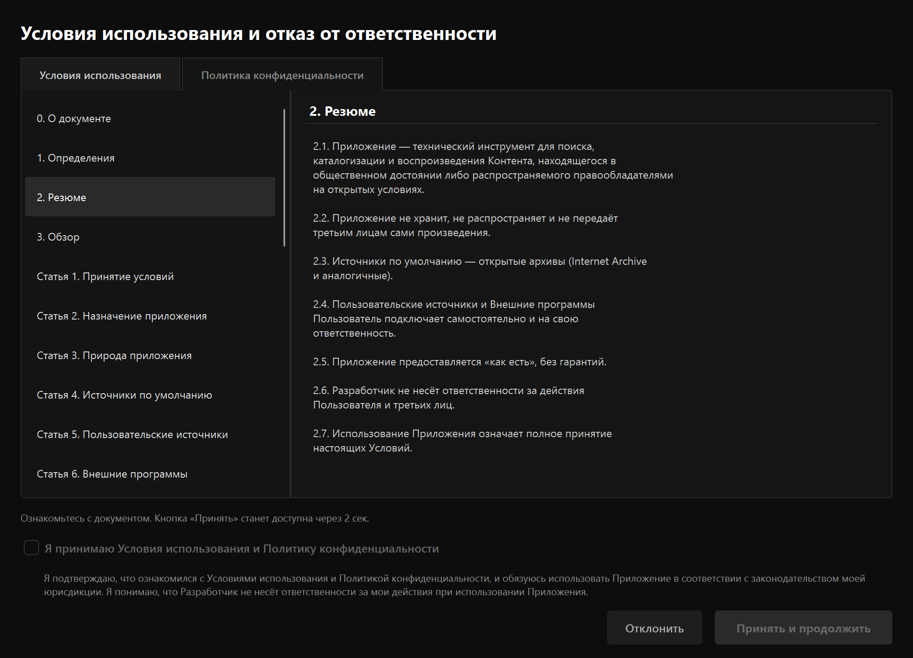
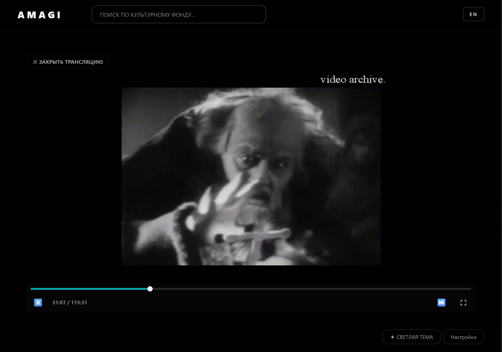
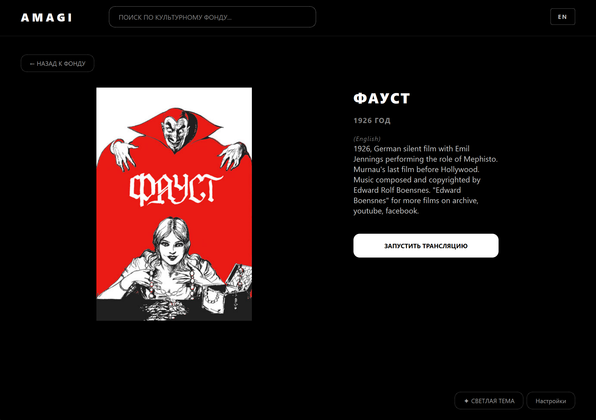
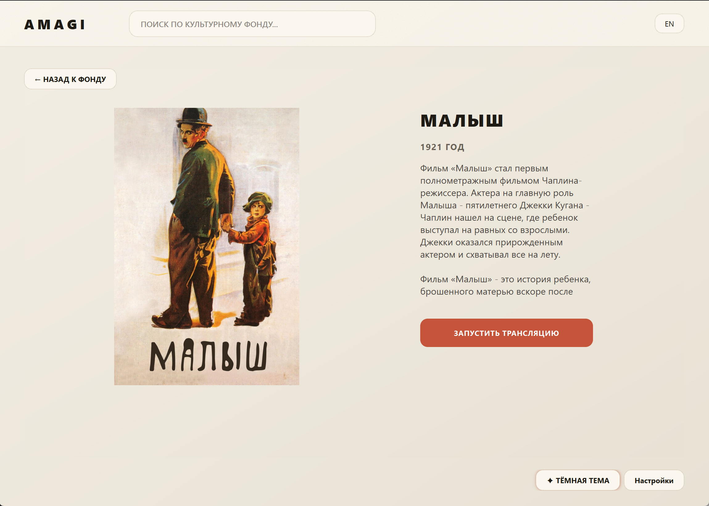
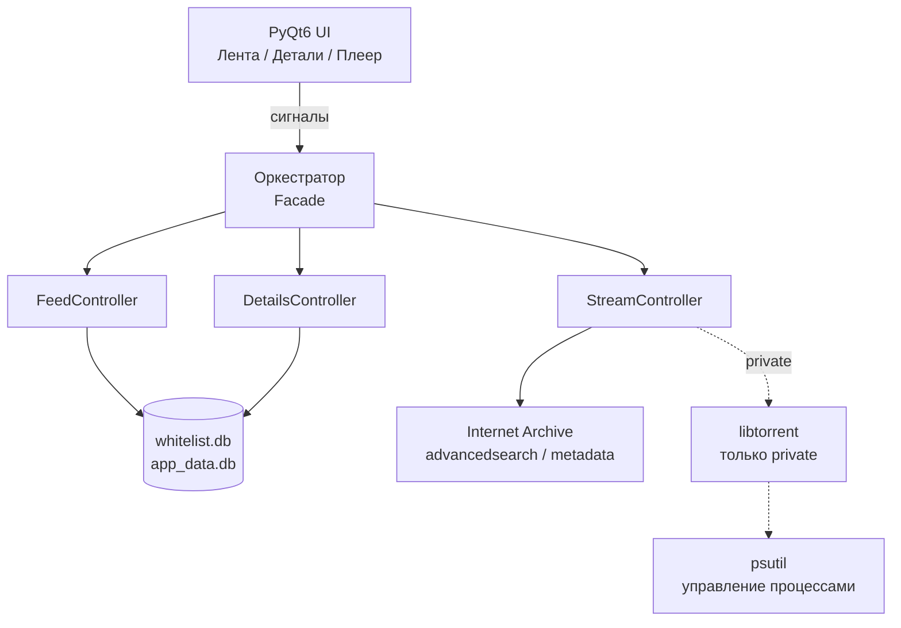
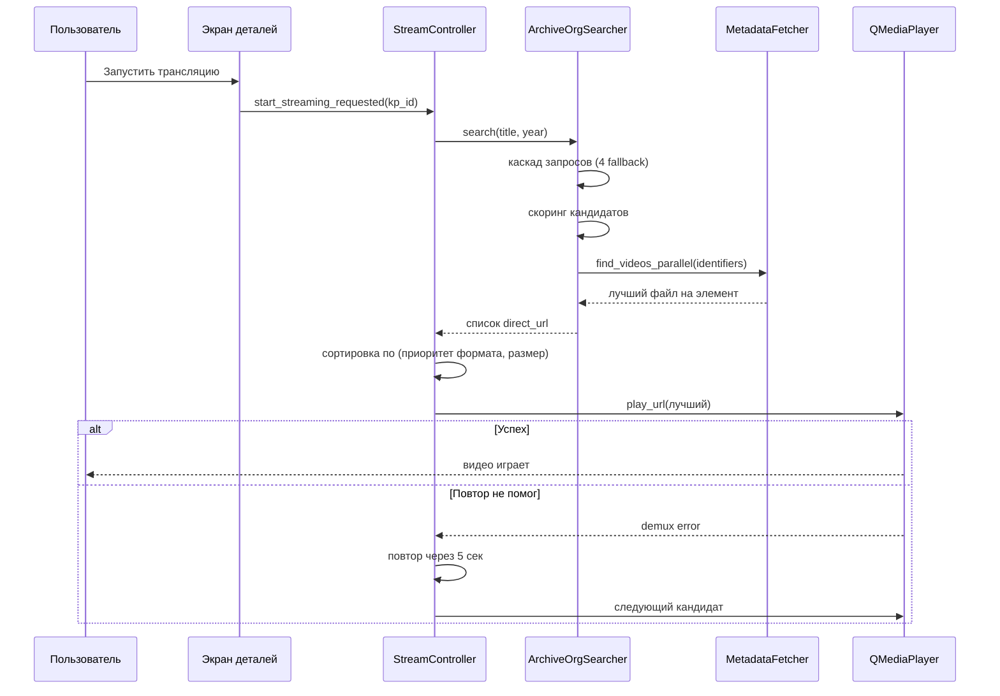

[🇬🇧 English](README.md) | [🇷🇺 Русский](README.ru.md)

<div align="center">

# Amagi-Player

**Смотрите кино общественного достояния из Internet Archive — прямо на рабочем столе.**

[](https://github.com/AkashaForge/ama-gi-player/releases)
[](https://github.com/AkashaForge/ama-gi-player/actions/workflows/release.yml)
[](https://www.gnu.org/licenses/gpl-3.0)
[](https://www.python.org/)
[]()
[](http://makeapullrequest.com)

</div>

<p align="center">
  <a href="#возможности">Возможности</a> •
  <a href="#быстрый-старт">Быстрый старт</a> •
  <a href="#установка">Установка</a> •
  <a href="#использование">Использование</a> •
  <a href="#архитектура">Архитектура</a> •
  <a href="#faq">FAQ</a> •
  <a href="#участие-в-разработке">Участие</a>
</p>

<p align="center">
  <a href="https://github.com/AkashaForge/ama-gi-player/releases/latest">
    
  </a>
</p>

---

## Скриншоты

### Тёмная тема (OLED)

<div align="center">

| | |
|---|---|
|  |  |
|  |  |

</div>

### Светлая тема (Gallery Editorial)

<div align="center">

| | |
|---|---|
|  |  |

</div>

---

<details>
<summary><strong>Содержание</strong></summary>

- [О проекте](#о-проекте)
- [Название](#название)
- [Возможности](#возможности)
- [Быстрый старт](#быстрый-старт)
- [Установка](#установка)
- [Использование](#использование)
- [Как это работает](#как-это-работает)
- [Конкурентность и контроль процессов](#конкурентность-и-контроль-процессов)
- [Как собирается релиз](#как-собирается-релиз)
- [Технологический стек](#технологический-стек)
- [Архитектура](#архитектура)
- [Конфигурация](#конфигурация)
- [Диагностика](#диагностика)
- [Решение проблем](#решение-проблем)
- [FAQ](#faq)
- [Разработка](#разработка)
- [Структура проекта](#структура-проекта)
- [Планы](#планы)
- [Участие в разработке](#участие-в-разработке)
- [Благодарности](#благодарности)
- [Правовая информация](#правовая-информация)
- [Лицензия](#лицензия)

</details>

---

## О проекте

Amagi-Player — десктопное приложение для поиска и воспроизведения
аудиовизуальных произведений, находящихся в **общественном
достоянии** либо распространяемых правообладателями на открытых
условиях (Creative Commons, Open Access и аналогичные режимы).

Приложение построено вокруг **Internet Archive** — одного из
крупнейших открытых архивов в мире, с публичным API и прямой
HTTP-доставкой файлов. Amagi-Player использует штатные механизмы
архива (`advancedsearch`, `metadata`, `download`) и не хранит
и не распространяет сами произведения. Это клиент, а не библиотека.

Приложение работает **локально**, без аналитики и телеметрии.
Сетевые запросы идут только к тем источникам, которые пользователь
явно использует для поиска и воспроизведения.

## Название

Проект называется **Amagi-Player**. Название вдохновлено
древнешумерским словом 𒂼𒄄 *ama-gi* («свобода», «возвращение к
матери»).

Слаг репозитория — `ama-gi-player` (с дефисом, унаследовано от
шумерской формы). Исполняемый файл — `amagi-player` (без дефиса).
Оба варианта относятся к одному проекту.

---

## Возможности

### Public-режим — поддерживается

Это поддерживаемый режим и единственный, документированный для
конечных пользователей. Он целиком сосредоточен на легальном
контенте общественного достояния.

- Курированная лента фильмов общественного достояния, поставляется
  вместе с релизом и доступна офлайн (~130 фильмов: ранний Чаплин,
  немецкий экспрессионизм, американская классика с истёкшим
  копирайтом)
- Поиск по названию в локальном каталоге
- Каскад постеров: локальный кэш → постеры из релиза →
  Internet Archive → опционально Кинопоиск
- Карточка фильма: название, год, описание, постер
- Стриминг напрямую с `archive.org/download/...` через
  QMediaPlayer + FFmpeg (с HTTP Range для перемотки)
- Функция «Продолжить просмотр» на основе локальной истории
- Две темы интерфейса (тёмная OLED, светлая Gallery Editorial)
- **Двуязычный поиск по контенту** (EN / RU) — кнопка EN/RU в шапке
  переключает **язык поиска** (какие фильмы показывать), а не язык
  интерфейса. Интерфейс пока только на русском.
- Без аналитики, телеметрии и аккаунтов

### Private-режим — экспериментальный, только для разработчиков

Private-режим — это экспериментальная площадка для тестирования
архитектуры поиска. Он **не** документируется, **не** поддерживается
и **не рекомендуется** обычным пользователям. Он существует в
коде для разработчиков, которые хотят расширять или
экспериментировать с поисковым конвейером.

Что в нём есть — для справки:

- Потоковое воспроизведение через **libtorrent** — magnet-ссылки
  и `.torrent`-файлы от внешних источников (не из Internet Archive)
- Интеграция с локальными индексаторами **Jackett** / **Prowlarr**
- Пользовательские источники через `data/sources.txt`
- Окно выбора альтернативного источника при нестабильном стриме
- Headless-парсинг сайтов через **nodriver** для обхода Cloudflare
  на публичных трекерах
- Пользовательские списки трекеров через `data/tracker_balancers.txt`
- Мультиисточниковый поиск с составным health-score
- Опциональная интеграция с TorAPI (требует подписки)

Ничего из этого не требуется для public-режима. Если вы
пользователь — оставайтесь в public.

### Технические особенности

- Асинхронная архитектура на `asyncio` + `qasync` — интерфейс не
  блокируется во время поиска, буферизации и воспроизведения
- Блокирующий I/O (чтение файлов кэша, запись постеров, очистка
  торрентов) вынесен в `run_in_executor` — event loop asyncio
  остаётся отзывчивым
- QMediaPlayer API синхронный по дизайну Qt; вызовы воспроизведения
  обёрнуты в `QTimer.singleShot` где возможно, но короткая задержка
  UI при остановке медиа — известное ограничение Qt
- Контроль дочерних процессов через `psutil` — «повисшие»
  процессы завершаются корректно
- LRU-кэш метаданных Internet Archive с TTL
- Аккуратное завершение работы с очисткой дочерних процессов,
  кэшей и фоновых задач

---

## Быстрый старт

**Windows** (требуется Windows 10/11):

1. Скачайте [latest release](https://github.com/AkashaForge/ama-gi-player/releases/latest)
2. Распакуйте архив в любую папку
3. Запустите `amagi-player.exe`

Каталог фильмов поставляется вместе с релизом — первое
воспроизведение доступно сразу.

**Из исходников** (Python 3.10+):

```bash
git clone https://github.com/AkashaForge/ama-gi-player.git
cd ama-gi-player
python -m venv .venv
.venv\Scripts\activate          # Windows
# source .venv/bin/activate     # Linux
pip install -r requirements.txt
python main.py
```

---

## Установка

### Из Releases (рекомендуется)

1. Скачайте архив со страницы [**Releases**](https://github.com/AkashaForge/ama-gi-player/releases)
2. Распакуйте в любую папку
3. Запустите `amagi-player` (Windows: `amagi-player.exe`)
4. Примите условия использования

Локальный каталог `data/whitelist.db` поставляется в архиве уже
заполненным — он копируется из `data/whitelist_seed.db` при сборке.
Если его удалить, при следующем запуске будет создана пустая
таблица и лента останется пустой до восстановления — см.
`tools/apply_seed.py` в исходниках.

### Из исходников

```bash
git clone https://github.com/AkashaForge/ama-gi-player.git
cd ama-gi-player
python -m venv .venv
.venv\Scripts\activate        # Windows
pip install -r requirements.txt
python main.py
```

### Требования

- **Windows 10/11** — поддерживается
- **Linux** — экспериментальная сборка в том же релизе, не
  тестировалась на всех дистрибутивах; требует системных
  библиотек (см. `README-LINUX.txt` в архиве)
- ~300 МБ свободного места под архив, ~500 МБ в распакованном виде
- Доступ в интернет для поиска и воспроизведения
- Python 3.10+ (только для запуска из исходников)

---

## Использование

1. Запустите приложение и примите условия использования.
2. Пролистайте ленту или введите поисковый запрос.
3. Кликните по карточке — откроется экран деталей.
4. Нажмите **«Запустить трансляцию»** — воспроизведение начнётся
   автоматически.
5. Используйте встроенный плеер: пауза, перемотка, полный экран.
6. Чтобы вернуться к фильму позже — «Продолжить просмотр» на
   главном экране.

Кнопка EN/RU в шапке переключает **язык поиска** (какие фильмы
показывать). Сам интерфейс пока только на русском — английская
локализация в [планах](#планы).

---

## Как это работает

Public-режим состоит из двух этапов: **лента** (локально) и
**воспроизведение** (сеть).

### Этап 1 — лента (локально)

1. Пользователь открывает приложение и видит сетку карточек из
   локального курированного каталога.
2. Пользователь может ввести запрос — поиск идёт по локальной
   базе (`data/whitelist.db`). Для пустого запроса показываются
   последние записи каталога.
3. Для каждой карточки постер разрешается каскадом: локальный
   runtime-кэш → постеры из seed → превью с Internet Archive →
   опционально Кинопоиск.
4. Клик по карточке открывает экран деталей с названием, годом,
   описанием и постером. Метаданные берутся из локального
   каталога; для записей без идентификатора Кинопоиска
   показываются только поля, сохранённые в каталоге.

Каталог (`data/whitelist_seed.db`) готовится заранее утилитами из
`tools/` и поставляется в архиве уже заполненным. Для этапа 1
сетевые запросы не требуются.

### Этап 2 — воспроизведение (сеть)

Когда пользователь нажимает **«Запустить трансляцию»**, плеер
идёт на Internet Archive. Архив — большой, открытый, но не
всегда аккуратный: качество метаданных разнится, один и тот же
фильм часто залит несколько раз разными пользователями, а файлы
внутри одного элемента могут быть и чистым MP4, и DVD-образом,
который не перематывается по HTTP. Поисковый конвейер построен
с учётом этой реальности.

**1. Каскад запросов.** Поиск — не один запрос, а серия. Плеер
пробует по очереди: по названию, году и типу медиа; по названию и
году без фильтра по типу; по названию и типу медиа без года; и
только по названию. Каждый fallback нужен потому, что у части
записей архива нет поля `year` или `mediatype`, и строгий первый
запрос их бы отсеял. Год сопоставляется с небольшим допуском
(±2 года) — метаданные архива часто ошибаются на год-два.

**2. Сбор кандидатов.** Каждый запрос возвращает пул кандидатов.
Вместо того чтобы брать несколько верхних по популярности, плеер
держит более широкий пул и скорирует всех. Известная загрузка
может «утопить» более тихую, но правильную, если смотреть только
на число скачиваний.

**3. Скоринг.** Каждый кандидат оценивается по:

- **Совпадению языка** — в public-режиме предпочтителен английский,
  русский как альтернатива
- **Точности названия** — сколько значимых слов запроса
  встречается в названии или идентификаторе, без учёта
  стоп-слов
- **Популярности** — как мягкий сигнал, не жёсткий фильтр

Немое кино обрабатывается отдельно: язык **не** используется как
дисквалификатор. Старые фильмы часто помечены языком субтитров, а
не оригинальным, и строгий языковой фильтр отсеял бы большую часть
раннего кино.

**4. Выбор файла внутри элемента.** Для каждого кандидата, прошедшего
скоринг, плеер загружает метаданные и сканирует список файлов.
Выбранный файл — не обязательно самый большой: плеер
**предпочитает прогрессивные контейнеры** (mp4, webm, mkv, m4v)
перед DVD-эпохой (mpeg, mpg, wmv, avi). Это осознанный
компромисс: MP4 вдвое меньшего размера будет надёжно
перематываться по HTTP, а MPEG может выглядеть нормально вначале
и сломаться на первой же перемотке из-за DVD navigation-пакетов.
Файлы DVD-эпохи всё равно принимаются, если лучшего варианта в
этом элементе нет — лучше что-то, чем ничего.

**5. Воспроизведение с повтором.** Плеер берёт лучшего кандидата и
запускает воспроизведение. Если стрим упал — сетевой сбой, 5xx от
CDN архива или неподдерживаемый контейнер — плеер повторяет
запрос к тому же URL один раз через короткую задержку (5 сек). Это
покрывает временные ошибки CDN, которые archive.org иногда
возвращает.

**6. Fallback по кандидатам.** Если повтор тоже не помог, плеер
переходит к следующему кандидату в упорядоченном списке.
Поскольку один и тот же фильм часто залит несколько раз под
разными идентификаторами, следующий кандидат — часто другая
загрузка того же фильма: иногда другого формата, иногда другого
качества. Цикл продолжается, пока не найдётся рабочий источник
или пока не закончатся кандидаты.

### Надёжность

- **Приоритет формата** важнее размера файла — самый большой файл
  не обязательно лучший для HTTP-стриминга
- **Повтор при временных ошибках** перед переключением на другой
  источник
- **Перебор кандидатов** — для одного фильма на архиве обычно
  есть несколько элементов
- **LRU-кэш метаданных** — повторные поиски не дёргают архив
  заново
- **Никаких блокирующих вызовов** в UI-потоке для поиска и
  метаданных; QMediaPlayer API остаётся синхронным по дизайну Qt
  и минимизирован через `QTimer.singleShot`

### Дополнительно

- **Кэш постеров и метаданных** — в `data/cache/`, с инвалидацией
  по TTL
- **История просмотров** — в `data/app_data.db`, обеспечивает
  «Продолжить просмотр»

---

## Конкурентность и контроль процессов

Приложение работает на одном событийном цикле, общем для Qt и
asyncio. Мост — **qasync**: он позволяет циклу Qt управлять
корутинами asyncio и наоборот. Второго потока нет, блокировок
нет, гонок между кодом интерфейса и сетевым кодом тоже нет.

Сетевая работа — поиск, метаданные, загрузка постеров — написана
как `async` / `await`. Интерфейс остаётся отзывчивым, пока она
выполняется. Работа, которую нельзя сделать асинхронной (чтение
файла, запись постера, обращение к кэшу, очистка папки загрузок
торрента), выносится в пул потоков через `run_in_executor`.
Event loop asyncio не блокируется системным вызовом.

QMediaPlayer API синхронный по дизайну Qt. Вызовы воспроизведения,
которые могут быть медленными (`setSource`, `stop`), обёрнуты в
`QTimer.singleShot` где возможно, чтобы отдать управление main
thread, но короткая задержка UI при остановке медиа — известное
ограничение Qt, а не баг Amagi-Player.

Дочерние процессы, которые запускает поисковый конвейер —
Jackett в private-режиме, headless-браузеры через `nodriver` —
отслеживаются через **psutil**. На старте убиваются остатки
прошлых упавших сессий, ещё до появления интерфейса.
Периодический таймер (раз в минуту) завершает подвисшие процессы
браузеров. При выходе чистится всё дерево процессов: даже жёсткое
падение в прошлом запуске не оставляет сирот.

---

## Как собирается релиз

Приложение компилируется через **Nuitka**. Это не упаковщик,
который складывает `.py`-файлы в архив, — Nuitka транслирует
Python в C, затем компилирует этот C нативным тулчейном (MSVC на
Windows) и линкует результат в единый исполняемый файл. Ваш код
и pure-Python-библиотеки, от которых он зависит, попадают в
`amagi-player.exe` как машинный код.

Что лежит рядом с исполняемым файлом:

- **Qt6** — runtime-DLL, плагины и ресурсы QML/WebEngine
- **Python runtime** (`python3XX.dll`) — нужен, потому что
  скомпилированный код по-прежнему использует объектную модель
  CPython во время работы
- **C-расширения**, которые нельзя статически скомпилировать, —
  `libtorrent`, `curl_cffi` и подобные
- **Данные приложения** — `data/`, `ui/`

Именно поэтому распакованная папка весит около **500 МБ**:
сам исполняемый файл — это несколько десятков мегабайт, а
остальное — runtime и нативные зависимости. ZIP в релизе
существенно меньше, потому что всё это хорошо сжимается.

Standalone-сборка сознательно **не** сделана как один
`.exe`-файл. Один файл распаковывал бы несколько сотен мегабайт
во временную папку при каждом запуске — это медленный старт и
лишнее внимание антивирусов. Папка стартует мгновенно и держит
всё в одном месте.

Пайплайн сборки работает на GitHub Actions. На каждый релизный
тег он собирает:

- Windows standalone — поддерживаемая сборка
- Linux standalone — экспериментальная, требует системных
  библиотек, не тестировалась на всех дистрибутивах

---

## Технологический стек

| Слой | Технология | Назначение |
|---|---|---|
| Язык | Python 3.10+ | Основной язык |
| GUI | PyQt6 | Пользовательский интерфейс |
| Event loop | qasync | Мост между asyncio и Qt |
| HTTP | aiohttp | Асинхронные запросы к Internet Archive |
| Медиа | QMediaPlayer + FFmpeg | Воспроизведение |
| Процессы | psutil | Управление дочерними процессами |
| XML safety | defusedxml | Безопасный парсинг Torznab (private) |
| Стриминг (private) | libtorrent | BitTorrent-воспроизведение (экспериментально) |
| HTTP fallback (private) | cloudscraper, curl_cffi | Каскад обхода Cloudflare |
| Браузерная автоматизация (private) | nodriver | Headless-парсинг сайтов (private) |
| Транспорт (private) | websockets | Транспорт для nodriver |
| Сборка | Nuitka | Python → C → нативный исполняемый файл |
| Тесты | pytest | Юнит-тесты |

---

## Архитектура



Слои:

- **UI** — виджеты PyQt6, только отрисовка и сигналы
- **Контроллеры** — лента, детали, стрим; управляют состоянием
- **Сервисы** — поиск по Internet Archive, метаданные, воспроизведение
- **Данные** — базы SQLite и файловые кэши

Public-режим касается только ветки Internet Archive. Ветка
libtorrent существует для private-режима и не используется
обычными сборками.

### Поток воспроизведения (public-режим)



---

## Конфигурация

### Режимы

Приложение работает в одном из двух режимов, определяемых файлом
`data/mode.txt`. Если файла нет — используется `public`.

| Режим | Статус | Назначение |
|---|---|---|
| `public` | Поддерживается | Только Internet Archive. Режим по умолчанию |
| `private` | Экспериментальный (разработчики) | Расширенная архитектура, не поддерживается |

### Опциональные метаданные

Для расширенных метаданных фильмов (более длинные описания,
постеры высокого разрешения) можно разместить **ключ API
Кинопоиска** в файле `.env` рядом с исполняемым файлом:

```text
KP_API_KEY=your_key
```

Без ключа приложение работает полностью с метаданными, уже
сохранёнными в локальном каталоге, и с метаданными Internet
Archive. Отсутствие ключа ничего не ломает.

---

## Диагностика

Приложение выводит диагностические сообщения в консоль
(открывается вместе с исполняемым файлом). Большинство
сообщений — на русском; таблица ниже расшифровывает их
назначение.

| Строка в логе | Что означает |
|---|---|
| `[CONFIG] Режим: PUBLIC` | Активен public-режим |
| `[CONFIG] Режим: PRIVATE` | Активен private-режим |
| `Лента: page=N, M фильмов` | Страница ленты загружена |
| `IA query: title:(...)` | Запрос к Internet Archive |
| `IA итог: N direct_url` | Найдено N воспроизводимых кандидатов |
| `StreamSession ready` | P2P-поток настроен, начинается воспроизведение (private) |
| `wait_piece N: X.Xs` | Ожидание piece N в течение X.X секунд (private) |
| `DEMUX ERROR` | Ошибка воспроизведения — последует retry или fallback |
| `WATCHDOG: Xs, rate=Y, peers=Z → fallback` | Буфер застрял, переключение на следующий источник |

Если приложение не запускается — запустите его из PowerShell,
чтобы увидеть полный traceback:

```powershell
cd <папка>
.\amagi-player.exe
```

---

## Решение проблем

### Приложение не запускается на Windows

Windows SmartScreen может блокировать незнакомый `.exe`:

1. Правый клик на `amagi-player.exe` → **Свойства**
2. Внизу вкладки **Общие** — галочка **Разблокировать**
3. OK → запустить заново

Если не помогло — запустить из PowerShell, чтобы увидеть
traceback:

```powershell
cd C:\путь\к\amagi-player
.\amagi-player.exe
```

### Антивирус удаляет `amagi-player.exe`

Nuitka-сборки иногда ложно детектируются антивирусами (нет
подписи кода). Это известная проблема Python-приложений.
Решения:

- Добавить папку в исключения антивируса
- Скачать из официального релиза (не сторонних зеркал)
- Собрать из исходников — см.
  [Как собирается релиз](#как-собирается-релиз)

Подпись кода запланирована — см. [Планы](#планы).

### Linux: `error while loading shared libraries`

Установить системные библиотеки:

```bash
sudo apt install libxcb-cursor0 libegl1 libgl1 libnss3 libasound2 ffmpeg
```

Полный список — в `README-LINUX.txt` внутри архива.

### Нет звука

1. Проверить системный микшер — приложение не блокирует звук
2. **Настройки → Звук** — правильно ли выбрано устройство вывода
3. Некоторые фильмы — немое кино (до 1930), в источнике
   может не быть звуковой дорожки. Это норма, не баг.

### Поиск не находит фильм

Проверить:

- Убрать год из запроса
- Кнопка EN/RU в шапке переключает **язык контента**, не
  интерфейса — проверить, что выбрано правильно
- Лог в консоли: строка `IA query: ...` покажет реальный запрос,
  отправленный в архив

### «Окно не отвечает» при переключении фильмов

Известное ограничение Windows Media Foundation: `QMediaPlayer`
держит file handle дольше, чем хотелось бы, и libtorrent не может
удалить торрент до освобождения storage. В коде есть sync fallback
через 15 секунд — подождите, переключение завершится.

Для более плавной работы — переключиться на FFmpeg backend через
переменную окружения перед запуском:

```powershell
$env:QT_MEDIA_BACKEND = "ffmpeg"
.\amagi-player.exe
```

FFmpeg делает демуксинг в отдельном потоке, что обходит блокировку
main thread при остановке. Это не включено по умолчанию, потому
что не тестировалось на всех конфигурациях Windows.

---

## FAQ

<details>
<summary><strong>Это легально?</strong></summary>

Да. Приложение работает только с контентом общественного достояния
(public domain) из Internet Archive — открытого архива с миллионами
свободных произведений. Приложение не хранит и не распространяет
произведения — это клиент к открытому API архива. Подробности — в
разделе [Правовая информация](#правовая-информация).

</details>

<details>
<summary><strong>Где взять фильмы?</strong></summary>

Нигде не нужно «брать» — каталог поставляется в архиве. Это около
130 фильмов, проверенных на статус public domain (Чаплин 1914–1919,
немецкий экспрессионизм, американская классика с истёкшим
копирайтом). Поиск работает по этому каталогу.

Если хочется больше — можно перейти в `private`-режим (см.
[Конфигурация](#конфигурация)) и подключить внешние источники.
Но это экспериментальный режим для разработчиков.

</details>

<details>
<summary><strong>Почему нет английского интерфейса?</strong></summary>

Кнопка EN/RU в шапке переключает **язык поиска** (какие фильмы
показывать), а не язык интерфейса. Интерфейс пока на русском.
Локализация в [планах](#планы).

</details>

<details>
<summary><strong>Как сменить тему?</strong></summary>

Кнопка «✦ СВЕТЛАЯ ТЕМА» / «✦ ТЁМНАЯ ТЕМА» внизу главного экрана.
Две темы: тёмная OLED (по умолчанию) и светлая Gallery Editorial.

</details>

<details>
<summary><strong>Можно ли скачать фильм, а не смотреть онлайн?</strong></summary>

Прямой функции «скачать» нет. Но стриминг идёт с
`archive.org/download/...` — открытого URL, который можно скачать
любым менеджером загрузок. Лог в консоли покажет точный URL.

</details>

<details>
<summary><strong>Приложение собирает мои данные?</strong></summary>

Нет. Никакой аналитики, телеметрии, аккаунтов. Все данные —
локально: история просмотров в `data/app_data.db`, кэш постеров
в `data/cache/`. Сетевые запросы — только к Internet Archive (и
Kinopoisk, если ключ задан).

</details>

<details>
<summary><strong>Что такое `mode.txt`?</strong></summary>

Файл `data/mode.txt` определяет режим:

- `public` (по умолчанию) — только Internet Archive, легальный
  контент
- `private` — расширенный стек (libtorrent, Jackett, nodriver).
  Экспериментально, не для обычных пользователей

</details>

<details>
<summary><strong>Приложение зависает при переключении фильмов</strong></summary>

Известное ограничение Windows Media Foundation (см.
[Решение проблем](#решение-проблем)). Обход: подождать 2–3 секунды
после закрытия перед запуском следующего, либо установить
`QT_MEDIA_BACKEND=ffmpeg` перед запуском.

</details>

---

## Разработка

### Setup

```bash
git clone https://github.com/AkashaForge/ama-gi-player.git
cd ama-gi-player
python -m venv .venv
.venv\Scripts\activate          # Windows
# source .venv/bin/activate     # Linux
pip install -r requirements.txt
```

Dev-инструменты (pytest, ruff, black, mypy) не входят в
`requirements.txt` — установить отдельно:

```bash
pip install pytest ruff black mypy
```

### Запуск тестов

```bash
pytest
```

### Линтеры и форматирование

Проект использует **ruff** (линтер) и **black** (форматтер).
Настройки в `pyproject.toml`.

```bash
ruff check .
ruff check . --fix
black .
```

### Стиль коммитов

Conventional Commits:

```
feat: add TorAPI source to coordinator
fix: async_remove_torrent не удалял handles при cancel
docs: обновить troubleshooting для Windows MF
refactor: разбить StreamController на 3 подконтроллера
```

### Добавление новой зависимости

Если действительно нужен новый пакет:

1. Добавить с пином версии в `requirements.txt`
2. Обновить этот README на **обоих** языках, если изменение
   видно пользователям
3. Запустить приложение и `pytest` — убедиться, что ничего
   не сломалось

---

## Структура проекта

```text
ama-gi-player/
├── controllers/              # Qt-контроллеры (state + UI ↔ services)
│   ├── orchestrator.py       # Facade, DI-контейнер
│   ├── feed_controller.py
│   ├── details_controller.py
│   └── stream/               # Stream subsystem
│       ├── stream_controller.py
│       ├── buffer_monitor.py
│       ├── cascade.py
│       └── fallback.py
├── core/                     # Инфраструктура
│   ├── config_loader.py
│   ├── logging_setup.py
│   ├── models.py
│   └── utils.py
├── data/                     # Локальные данные
│   ├── whitelist_seed.db     # Каталог (в релизе)
│   ├── whitelist.db          # Рабочая копия (создаётся из seed)
│   ├── app_data.db           # История просмотров
│   ├── cache/                # Runtime-кэш
│   ├── mode.txt              # public / private
│   └── sources.txt           # (private) пользовательские источники
├── database/                 # SQLite-репозитории
│   ├── connection.py
│   ├── whitelist_db.py
│   ├── whitelist_repo.py
│   ├── history_repo.py
│   ├── resolve_kp_ids.py
│   └── whitelist_seed.py
├── docs/
│   └── screenshots/
├── search/                   # Поисковый конвейер
│   ├── aggregator/           # Параллельный поиск
│   │   ├── coordinator.py
│   │   ├── language_filter.py
│   │   ├── source_counters.py
│   │   └── tasks/            # 6 источников (IA, Jackett, web, YTS, ...)
│   ├── archive_org/          # Internet Archive
│   │   ├── searcher.py
│   │   ├── metadata.py
│   │   └── language.py
│   ├── web_fetcher/          # Парсинг сайтов
│   │   ├── fetcher.py
│   │   ├── http_cascade.py   # curl_cffi → cloudscraper → aiohttp
│   │   ├── browser_fetcher.py
│   │   └── html_parser.py
│   ├── filters.py
│   ├── jackett_client.py
│   ├── prowlarr_client.py
│   └── torznab_parser.py
├── services/                 # Бизнес-логика
│   ├── torrent/              # P2P streaming (private)
│   │   ├── session/          # StreamSession подкомпоненты
│   │   ├── http_range_server.py
│   │   ├── piece_scheduler.py
│   │   ├── piece_map.py
│   │   ├── peer_monitor.py
│   │   ├── lt_session.py
│   │   ├── source_selector.py
│   │   ├── swarm_grouper.py
│   │   └── tracker_balancer.py
│   ├── playback_controller.py
│   ├── kp_service.py
│   ├── balancer_client.py
│   └── process_cleaner.py
├── tests/
│   └── test_smoke.py
├── tools/                    # Утилиты сборки каталога
│   ├── make_seed.py
│   ├── enrich_whitelist.py
│   ├── apply_seed.py
│   ├── verify_whitelist.py
│   ├── manage_whitelist.py
│   └── cache_stats.py
├── ui/                       # PyQt6-виджеты и стили
│   ├── main_window.py
│   ├── setup_wizard.py
│   ├── source_picker_dialog.py
│   ├── styles.qss
│   └── widgets/
├── legal_gate.py
├── legal_texts.py
├── switch_mode.py            # public ↔ private
├── main.py
├── config.py
├── pyproject.toml
├── nuitka-package-config.yml
├── requirements.txt
└── bin/                      # Опциональные внешние утилиты
```

---

## Планы

Планируемые улучшения (не гарантированы, без сроков):

### Ближайшее

- [ ] Английская локализация интерфейса (i18n через `QTranslator`) —
  сейчас EN/RU переключает только язык поиска
- [ ] Тесты на fallback-логику (public retry, private auto-fallback)
- [ ] Полный CI на Linux (сейчас экспериментальный)

### Средний срок

- [ ] Подпись кода (Windows) — убирает SmartScreen и часть
  false-positive антивирусов
- [ ] `QT_MEDIA_BACKEND=ffmpeg` по умолчанию на Windows — обходит
  часть ограничений MF
- [ ] Улучшение загрузки постеров (прогрессивная загрузка,
  blurhash-плейсхолдеры)

### Дальний срок

- [ ] macOS сборка
- [ ] ARM64 (Apple Silicon, Windows on ARM)
- [ ] Система плагинов для источников (сейчас — `sources.txt`)

Если хотите помочь — см. [Участие в разработке](#участие-в-разработке).

---

## Участие в разработке

PR и Issues приветствуются. Перед крупным PR:

1. Открыть issue с описанием идеи — обсудить подход
2. Сделать fork и ветку от `main`
3. Прогнать `pytest` и `ruff check .` локально
4. Открыть PR с описанием и ссылкой на issue

Подробности — в [`CONTRIBUTING.md`](CONTRIBUTING.md).

Отправляя PR, вы соглашаетесь лицензировать свой вклад под
**GPLv3**.

### Хорошие первые задачи

Issues с меткой
[`good first issue`](https://github.com/AkashaForge/ama-gi-player/labels/good%20first%20issue)
специально для новичков.

---

## Благодарности

Проект стоит на плечах отличных open-source инструментов:

- **[Internet Archive](https://archive.org)** — открытый архив с
  миллионами произведений в public domain. Без него проекта бы
  не было.
- **[PyQt6](https://riverbankcomputing.com/software/pyqt/)** —
  Qt bindings для Python.
- **[qasync](https://github.com/CabbageDevelopment/qasync)** —
  мост asyncio ↔ Qt event loop.
- **[Nuitka](https://nuitka.net)** — Python → C компилятор.
- **[libtorrent](https://libtorrent.org)** (rasterbar) —
  BitTorrent-библиотека (private mode).
- **[aiohttp](https://docs.aiohttp.org)** — асинхронный HTTP.
- **[curl_cffi](https://github.com/lexiforest/curl_cffi)** —
  TLS fingerprinting для CF bypass.
- **[nodriver](https://github.com/ultrafunkamsterdam/nodriver)** —
  headless Chrome без webdriver.
- **[Kinopoisk Unofficial API](https://kinopoiskapiunofficial.tech)** —
  опциональные метаданные.

Отдельное спасибо:

- Сообществу **Internet Archive** за открытые данные
- Контрибьюторам PyQt6 и qasync за ответы на GitHub
- Авторам фильмов в public domain — за культурное наследие

### Иконки

- [Feather Icons](https://feathericons.com) — UI-иконки
  (лицензия MIT)
- Emoji-флаги — системный шрифт

---

## Правовая информация

Amagi-Player распространяется под **GNU General Public License v3.0**.

- Полный текст лицензии — [`LICENSE`](LICENSE)
- Сторонние компоненты — [`LICENSES.txt`](LICENSES.txt)
- Атрибуция — [`NOTICE`](NOTICE)
- Политика подписи кода — [`CODE_SIGNING_POLICY.md`](CODE_SIGNING_POLICY.md)
- Политика безопасности — [`SECURITY.md`](SECURITY.md)
- Политика конфиденциальности — [`PRIVACY.ru.md`](PRIVACY.ru.md)
- Условия использования и политика конфиденциальности показываются
  при первом запуске (см. `legal_texts.py`)

Кратко:

- Приложение не хранит и не распространяет произведения.
- Источники по умолчанию — открытые архивы общественного
  достояния (Internet Archive).
- Приложение работает локально, без аналитики и телеметрии.

---

## Лицензия

```text
Amagi-Player
Copyright (C) 2026 AkashaForge

This program is free software: you can redistribute it and/or modify
it under the terms of the GNU General Public License as published by
the Free Software Foundation, either version 3 of the License, or
(at your option) any later version.

This program is distributed in the hope that it will be useful,
but WITHOUT ANY WARRANTY; without even the implied warranty of
MERCHANTABILITY or FITNESS FOR A PARTICULAR PURPOSE. See the
GNU General Public License for more details.

You should have received a copy of the GNU General Public License
along with this program. If not, see <https://www.gnu.org/licenses/>.
```